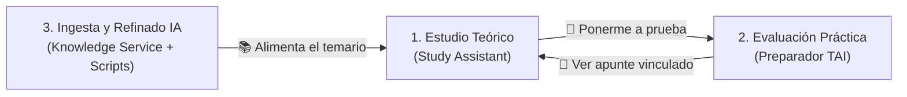
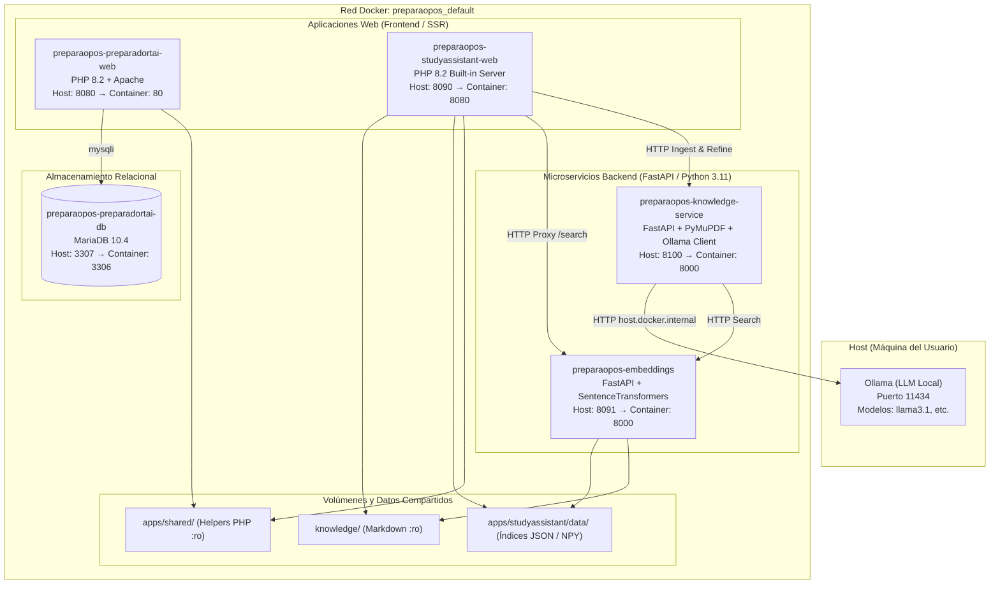

# Arquitectura Global del Ecosistema PreparaOpos

Documento técnico integral y exhaustivo de la arquitectura de software, infraestructura, módulos, modelos de datos y estado actual del ecosistema **PreparaOpos**.

> **Nota para IAs / Arquitectos de Software:** Este documento describe la totalidad del monorepo, sus subsistemas, tecnologías, patrones implementados, dependencias y deuda técnica actual con el objetivo de evaluar y diseñar una **estrategia de unificación arquitectónica óptima**.

---

## 1. Propósito y Misión de la Plataforma

**PreparaOpos** es una plataforma integral orientada a la preparación de oposiciones de cuerpos tecnológicos de la administración pública española (Administración General del Estado: **A2-GSI**, **C1-TAI**; Comunidad de Madrid; Ayuntamientos).

El ecosistema cubre el ciclo de estudio completo del opositor uniendo tres pilares:



1. **Estudio Teórico y Base de Conocimiento (`studyassistant`):**
   - Lectura de temas en Markdown estructurado con soporte para fórmulas $\LaTeX$ (MathJax), diagramas dinámicos (Mermaid.js), callouts normativos y tabla de contenidos (TOC) multinivel y colapsable.
   - Búsqueda híbrida: filtrado instantáneo por metadatos (procesos, perfiles, etiquetas, estados) y búsqueda semántica vectorial por significado (embeddings locales en CPU).
2. **Evaluación Práctica y Simulacros (`preparadortai`):**
   - Motor interactivo de exámenes oficiales con cronómetro, práctica libre por temas/bloques, relación de conceptos y refuerzo de fallos anteriores.
   - Persistencia granular de intentos por pregunta y cálculo de puntuaciones oficiales aplicando penalizaciones normativas ($A - \frac{F}{3}$ o $A - \frac{F}{4}$).
   - Panel de gestión para curación y justificación razonada del banco de preguntas.
3. **Ingesta Inteligente de Documentos (`services/knowledge` y `scripts/`):**
   - Extracción estructurada de texto y títulos desde documentos PDF/PPTX (temarios de academia, boletines oficiales BOE/BOCM).
   - Detección y supresión heurística de cabeceras/pies de página repetidos.
   - Refinado y estructuración de apuntes con LLMs locales (Ollama) sin costes de APIs externas.

---

## 2. Topología de Infraestructura y Contenedores

El proyecto está orquestado mediante **Docker Compose** (`docker-compose.yml`):



### Tabla de Puertos y Servicios

| Contenedor | Tecnología | Puerto Host | Puerto Contenedor | Propósito |
|---|---|---|---|---|
| `preparadortai-web` | PHP 8.2 / Apache | `8080` | `80` | Plataforma de exámenes, simulacros y gestión del banco de preguntas. |
| `preparadortai-db` | MariaDB 10.4 | `3307` | `3306` | Base de datos relacional de preguntas, respuestas, sesiones y usuarios. |
| `studyassistant-web` | PHP 8.2 CLI Server | `8090` | `8080` | Catálogo de apuntes, visor Markdown, TOC dinámico e interfaz de ingesta. |
| `embeddings` | Python 3.11 / FastAPI | `8091` | `8000` | Búsqueda semántica vectorial en CPU con `SentenceTransformers`. |
| `knowledge-service` | Python 3.11 / FastAPI | `8100` | `8000` | Extracción de PDFs con `PyMuPDF`, refinado con Ollama y publicación. |
| *Host (Externo)* | Ollama | `11434` | `11434` | Inferencia LLM local (`llama3.1:latest`, etc.). |

---

## 3. Arquitectura Detallada por Subsistema

### 3.1. `apps/studyassistant`: Visor de Apuntes y Base de Conocimiento

Aplicación en **PHP 8.2 nativo** recientemente refactorizada a un diseño modular orientado a objetos respaldado por un autocargador PSR-4 nativo.

#### Estructura de Directorios
```
apps/studyassistant/
├── assets/                  # CSS y JavaScript del cliente (styles.css, semantic-search.js)
├── data/                    # Índices estáticos precalculados (knowledge_index.json, etc.)
├── includes/                # Capa de compatibilidad e inicialización
│   ├── autoload.php         # Autocargador PSR-4 nativo (mapea StudyAssistant\ -> src/)
│   ├── header.php           # Template de cabecera común con MathJax y Mermaid
│   ├── knowledge.php        # Fachada procedural con funciones sa_* (retrocompatibilidad)
│   └── markdown.php         # Fachada procedural de renderizado (retrocompatibilidad)
├── src/                     # Núcleo Orientado a Objetos (OOP)
│   ├── Dashboard/
│   │   └── DashboardMetrics.php       # Agregaciones, conteos y chips de filtros
│   ├── Knowledge/
│   │   └── NoteRepository.php         # Repositorio Singleton, caché, búsqueda O(1), Path Traversal
│   ├── Markdown/
│   │   └── MarkdownRenderer.php       # Motor Markdown: MathJax, Mermaid, Quiz Cards, Tablas GFM
│   ├── Navigation/
│   │   └── TableOfContents.php        # Algoritmo de árbol jerárquico h2-h4 y acordeones
│   └── Service/
│       └── KnowledgeServiceClient.php # Cliente cURL tipado para microservicios Python
├── tests/
│   └── test_studyassistant.php        # Suite de pruebas automatizadas (65 tests, 0 fallos)
├── index.php                # Catálogo principal, métricas del Process Hub y filtros
├── note.php                 # Visor de apunte con TOC dinámico y botón de práctica
├── ingest.php               # Stepper interactivo de 4 pasos para carga de PDFs
├── search.php               # Proxy JSON hacia embeddings:8000
└── asset.php                # Servidor seguro de imágenes relativas (anti-path traversal)
```

#### Patrones de Diseño Implementados
- **Repository Pattern (`NoteRepository`)**: Desacopla el acceso al índice JSON en memoria, la ordenación secuencial por tema oficial y la verificación de rutas canónicas contra la raíz `knowledge/`.
- **Singleton Pattern (`NoteRepository::getInstance()`)**: Evita lecturas redundantes del archivo de índice de 140 notas en una misma petición.
- **Facade Pattern (`includes/knowledge.php` y `includes/markdown.php`)**: Mantiene disponibles 20+ funciones históricas `sa_*` (`sa_load_index`, `sa_render_markdown`, etc.) como delegados directos hacia las clases OOP para garantizar cero roturas en código externo.
- **Service Client (`KnowledgeServiceClient`)**: Encapsula llamadas cURL multiparte y JSON con timeouts defensivos (hasta 300s para LLM) y mapeo de excepciones `RuntimeException`.

---

### 3.2. `apps/preparadortai`: Plataforma de Exámenes y Tests

Aplicación web en **PHP 8.2 con Apache**, renderizado en servidor (SSR) asistido por JavaScript vanilla para interactividad en exámenes y persistencia asíncrona.

#### Estructura de Directorios
```
apps/preparadortai/
├── assets/                  # CSS (Bootstrap 5, custom styles) y JS de cronómetro y examen
├── includes/
│   ├── config.php           # Inicialización de conexión MariaDB con mysqli
│   ├── question_search.php  # Lógica de filtrado dinámico para el banco de preguntas
│   └── topic_links.php      # Consultas sobre question_topic_links
├── logic/                   # Endpoints asíncronos (AJAX)
│   ├── save_attempt.php     # Persistencia inmediata de cada respuesta emitida
│   ├── start_topic_test.php # Generación e inicio de sesión de test por tema
│   ├── submit.php           # Cierre de examen y cálculo final de nota
│   └── sync_question_sets.php
├── index.php                # Dashboard de progreso y accesos rápidos
├── test.php                 # Motor principal de ejecución de examen (cronómetro, navegación)
├── practica_tematica.php    # Lanzador de test parametrizado desde StudyAssistant (?topics=...)
├── refuerzo.php             # Batería automática de preguntas falladas
├── relacionar.php           # Modo de juego/estudio para emparejar conceptos
├── examenes.php             # Selección de convocatorias oficiales históricas
├── estadisticas.php         # Analítica detallada con aplicación de reglas oficiales de corrección
├── gestionar.php            # Buscador y tabla del banco de preguntas
├── agregar.php / editar.php # CRUD de preguntas, respuestas y justificaciones
└── categorias.php / temas.php # Mantenimiento de taxonomía y bloques
```

#### Modelo de Datos Clave (MariaDB `preparadortai`)
- `questions`: Preguntas (enunciado, tipo: test/relacionar, dificultad, año oficial, justificación, estado).
- `answers`: Opciones de respuesta vinculadas a cada pregunta (texto, si es correcta).
- `categories` / `topics`: Taxonomía organizativa por bloques y temas.
- `test_sessions`: Sesiones de examen iniciadas (modo, duración, fecha, puntuación total).
- `test_attempts`: Registro detallado de cada intento de respuesta (tiempo en responder, acierto/fallo).
- `question_topic_links`: Tabla de asociación semántica entre preguntas del test y temas de la base de conocimiento (`topic_name`, `process_slug`, `source`).
- `scoring_rules`: Parámetros de corrección oficial por convocatoria (penalización por fallo: $-0.33$, $-0.25$, puntuación mínima de corte).

---

### 3.3. `services/knowledge`: Microservicio de Ingesta y Procesamiento IA

Microservicio en **Python 3.11 con FastAPI** para la transformación de documentos no estructurados en notas limpias de Markdown.

#### Módulos Clave
- **`app.py`**: Router FastAPI que expone:
  - `POST /ingest/extract-pdf`: Recibe `multipart/form-data` con un PDF y aplica extracción.
  - `POST /ingest/refine`: Recibe JSON con Markdown bruto y envía el prompt a Ollama.
  - `POST /ingest/publish`: Guarda la nota procesada en la ruta `knowledge/processes/{process}/apuntes/{slug}.md` y regenera el índice.
- **`pdf_extractor.py`**: Extractor basado en `PyMuPDF` (`fitz`) con detección de:
  - Bloques de texto con tamaño tipográfico para inferir niveles de encabezado (`#`, `##`, `###`).
  - Bloques de cabecera y pie repetidos (números de página, títulos de documento) para eliminarlos.
  - Exclusión automática de páginas de índice o tabla de contenidos (TOC).
- **`markdown_normalizer.py`**: Heurísticas regex para arreglar roturas de línea artificiales de PDFs, unir palabras con guion de final de línea y limpiar caracteres espurios.
- **`ollama_client.py`**: Cliente HTTP asíncrono para comunicarse con el servidor Ollama local (`/api/generate` o `/api/chat`).
- **`schemas.py`**: Modelos estrictos `Pydantic v2` para validación de entrada/salida.

---

### 3.4. `services/embeddings`: Búsqueda Semántica Vectorial

Microservicio en **Python 3.11 con FastAPI** para búsqueda semántica basada en embeddings densos.

#### Componentes
- **`main.py`**:
  - Carga en memoria al inicio el modelo `paraphrase-multilingual-MiniLM-L12-v2` (~470 MB, 384 dimensiones) y los archivos `semantic_chunks.json` y `semantic_embeddings.npy`.
  - Normaliza la matriz de embeddings a norma euclídea unitaria ($L_2 = 1$).
  - `GET /search?q={query}&top_k={k}`: Codifica la consulta en un vector y realiza el producto escalar matricial contra todos los fragmentos con `numpy.dot`:
    $$\text{scores} = \mathbf{E} \cdot \mathbf{q}$$
  - Retorna los $k$ resultados con mayor puntuación en menos de 20 milisegundos en CPU.

---

### 3.5. `scripts/`: Pipeline de Procesamiento por Lotes y Utilidades

Conjunto de herramientas CLI en **Python** para el mantenimiento de la plataforma:
- `build_knowledge_index.py`: Escanea `knowledge/`, lee el YAML frontmatter, genera títulos, slugs, extractos y guarda `apps/studyassistant/data/knowledge_index.json`.
- `build_semantic_index.py`: Fragmenta apuntes por encabezados (`##`, `###`, `####`), calcula embeddings con SentenceTransformers y genera `semantic_chunks.json` y `semantic_embeddings.npy`.
- `suggest_topic_links.py`: Algoritmo de cruce que propone asociaciones entre preguntas de `preparadortai` y apuntes de `studyassistant` mediante coincidencia de texto y similitud.
- `extract_pdf_text.py` / `normalize_markdown.py` / `refine_markdown_llm.py`: Scripts reutilizables por línea de comandos para procesamiento por lotes de PDFs.

---

### 3.6. `apps/shared/`: Enlace Inter-Aplicaciones

Módulo PHP montado en ambas aplicaciones web (`apps/preparadortai` y `apps/studyassistant`):
- `helpers/url.php`: Funciones `build_preparadortai_topic_practice_url()` y `build_studyassistant_note_url()`.
- Permite que desde un apunte teórico en StudyAssistant (`note.php`) se pulse "📝 Ponerme a prueba" y se abra automáticamente un test temático en `preparadortai` con las preguntas correspondientes al tema leído.

---

## 4. Estado Actual del Proyecto ("Lo que está hecho")

| Capacidad / Módulo | Estado | Descripción técnica |
|---|---|---|
| **Base de Conocimiento Markdown** | **Completado** | 140 notas estructuradas con YAML frontmatter repartidas en AGE (A2-GSI: 81), Comunidad de Madrid (44) y Majadahonda (3). |
| **Visor de Apuntes Enriquecido** | **Completado** | Renderizado nativo de MathJax ($\LaTeX$), diagramas Mermaid.js, tarjetas interactivas de test y callouts normativos. |
| **Navegación y TOC Anidado** | **Completado** | Generación dinámica de árbol jerárquico h2-h4 con acordeones `<details><summary>` y enlaces directos con ancla `#`. |
| **Catálogo y Filtrado Léxico** | **Completado** | Dashboard con KPIs, filtros combinados por búsqueda, etiquetas, estado y proceso selectivo con chips removibles. |
| **Búsqueda Semántica Vectorial** | **Completado** | Microservicio FastAPI + SentenceTransformers en CPU; búsqueda instantánea por concepto sin APIs externas. |
| **Ingesta de PDFs con Heurísticas** | **Completado** | Extracción con PyMuPDF, eliminación de cabeceras/pies repetidos, normalización de saltos de línea y frontend con stepper de 4 pasos. |
| **Refinado Asistido por LLM** | **Completado** | Integración con Ollama local (`http://host.docker.internal:11434`) para limpieza y estructuración de apuntes. |
| **Motor de Exámenes y Simulacros** | **Completado** | Exámenes oficiales, práctica libre, cronómetro, persistencia AJAX respuesta a respuesta y modo relacionar conceptos. |
| **Analítica y Corrección Oficial** | **Completado** | Historial de sesiones, detalle de respuestas y aplicación de fórmulas de penalización oficiales ($A - \frac{F}{3}$, $A - \frac{F}{4}$). |
| **Enlace Teórico-Práctico** | **Completado** | Botón directo desde el apunte al test temático de PreparadorTAI vía `apps/shared/helpers/url.php`. |
| **Suite de Tests de StudyAssistant** | **Completado** | 65 pruebas unitarias automatizadas (`test_studyassistant.php`) verificadas con 0 fallos. |

---

## 5. Deuda Técnica y Oportunidades de Mejora ("Lo que queda pendiente")

Para abordar una unificación arquitectónica coherente, se identifican las siguientes fricciones:

### 5.1. Fragmentación de Lenguajes y Ecosistemas
- **El conflicto PHP vs Python**:
  - La lógica de datos, IA, embeddings, extracción de PDFs y scripts está en **Python** (`services/knowledge`, `services/embeddings`, `scripts/`).
  - La capa web y de usuario está dividida en dos aplicaciones **PHP**: `preparadortai` (PHP procedimental clásico) y `studyassistant` (PHP 8.2 modular OOP).
  - La desarrolladora principal **no está familiarizada con PHP** y domina mejor Python, lo que ralentiza el desarrollo y mantenimiento del frontend.

### 5.2. Dos Aplicaciones Web Separadas (Puertos 8080 y 8090)
- Actualmente el usuario debe saltar entre dos puertos distintos en el navegador (`localhost:8080` para tests y `localhost:8090` para teoría).
- No existe **sesión única ni autenticación compartida**: los progresos de lectura en StudyAssistant no están vinculados con los intentos de examen de PreparadorTAI más allá de un enlace GET por URL.

### 5.3. Disparidad en el Almacenamiento de Datos
- Las preguntas de examen residen en **MariaDB** (modelo relacional SQL).
- Los apuntes teóricos residen en **ficheros Markdown planos** en el disco (`knowledge/`) indexados en un archivo JSON (`knowledge_index.json`).
- La vinculación entre ambos se mantiene mediante la tabla `question_topic_links` que se actualiza periódicamente mediante un script Python (`suggest_topic_links.py`).

### 5.4. Duplicación de Lógica
- Existen parsers y normalizadores de Markdown tanto en Python (`services/knowledge/markdown_normalizer.py`) como en PHP (`StudyAssistant\Markdown\MarkdownRenderer.php`).
- Si se cambia una regla de formato en uno, hay que replicarla en el otro para mantener consistencia.

---

## 6. Guía para la IA / Arquitecto de Software: Preguntas para la Unificación

Si estás leyendo este documento para proponer la arquitectura unificada de **PreparaOpos**, ten en cuenta las siguientes restricciones y preguntas de decisión:

### Restricciones Críticas
1. **Sin costes de APIs externas:** Toda la IA (búsqueda semántica, embeddings y refinado) debe seguir ejecutándose localmente (Ollama y SentenceTransformers en CPU/GPU local).
2. **Máxima ligereza y simplicidad para una única desarrolladora:** Evitar frameworks hiper-complejos que requieran pipelines de compilación pesados o microservicios innecesarios si un monolito modular puede resolverlo.
3. **Preservación del valor de los datos:**
   - No perder los apuntes en Markdown (`knowledge/**/*.md`).
   - No perder el banco de preguntas y el histórico de exámenes de MariaDB.

### Preguntas Clave a Responder en la Propuesta de Unificación
1. **¿Cuál es la tecnología de backend ideal para unificar `preparadortai`, `studyassistant` y los servicios de IA?**
   - *Opción A: Python unificado (FastAPI o Django)*: ¿Tiene sentido absorber la lógica de MariaDB y los apuntes bajo un único backend en Python (FastAPI), unificando `services/knowledge` y las dos apps web?
   - *Opción B: Backend FastAPI + Frontend desacoplado (Astro o Next.js)*: ¿Es mejor dejar FastAPI como API REST unificada (con SQLModel/SQLAlchemy para MariaDB y endpoints de Markdown/IA) y crear un único frontend moderno en Astro (especialista en Markdown y ultra-rápido)?
2. **¿Cómo debe ser el modelo de datos unificado?**
   - ¿Deben los apuntes Markdown seguir siendo ficheros planos en disco o indexarse en una base de datos documental/relacional?
   - ¿Cómo unificar la tabla `question_topic_links` para que la relación entre preguntas tipo test y apartados de apuntes sea dinámica y bidireccional?
3. **¿Cuál sería el plan de migración por fases sin interrumpir el estudio diario del opositor?**
