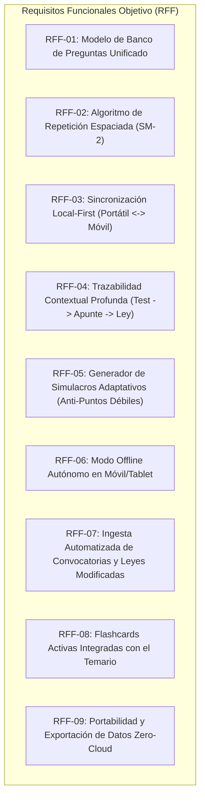
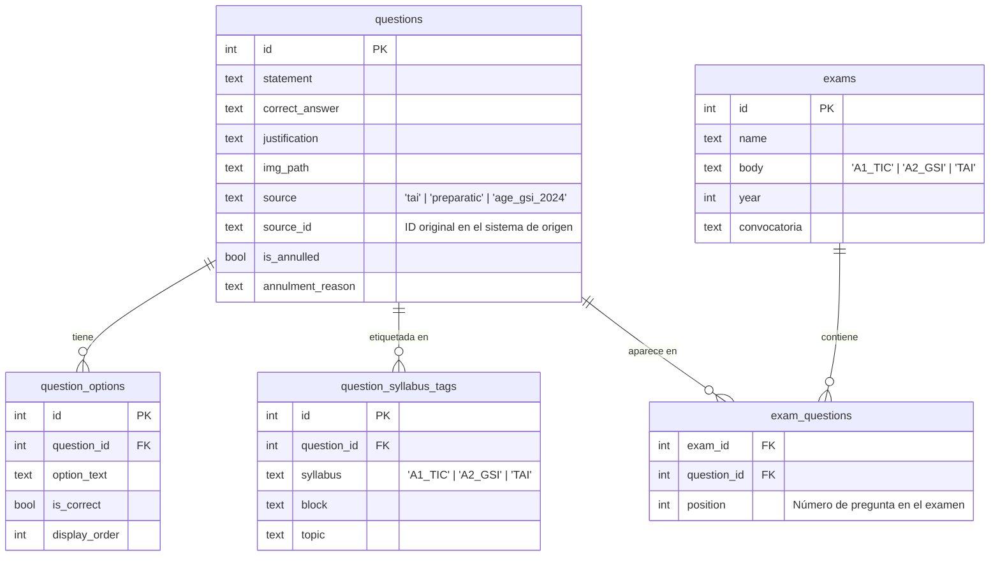

# Documento de Ingeniería de Software: Arquitectura del Sistema, Requisitos del Estado Actual y Requisitos Objetivo

**Proyecto:** PreparaOpos — Plataforma Integral de Preparación Tecnológica de Oposiciones  
**Estándar de Referencia:** Basado en ISO/IEC/IEEE 29148:2018 (Ingeniería de Requisitos) e ISO/IEC/IEEE 42010:2011 (Descripción de Arquitectura de Sistemas y Software)  
**Versión del Documento:** 2.0.0  
**Fecha:** 25 de septiembre de 2026  
**Estado:** Arquitectura Decidida — Referencia ADR-0001

---

## Índice

- [Documento de Ingeniería de Software: Arquitectura del Sistema, Requisitos del Estado Actual y Requisitos Objetivo](#documento-de-ingeniería-de-software-arquitectura-del-sistema-requisitos-del-estado-actual-y-requisitos-objetivo)
  - [Índice](#índice)
  - [1. Alcance y Objetivos del Documento](#1-alcance-y-objetivos-del-documento)
  - [2. Arquitectura del Sistema: Estado Actual (As-Is)](#2-arquitectura-del-sistema-estado-actual-as-is)
    - [2.1. Descomposición en Subsistemas](#21-descomposición-en-subsistemas)
    - [2.2. Diagrama de Contenedores y Flujo de Datos](#22-diagrama-de-contenedores-y-flujo-de-datos)
    - [2.3. Topología de Datos y Persistencia Actual](#23-topología-de-datos-y-persistencia-actual)
  - [3. Requisitos Funcionales del Estado Actual (RF Implementados)](#3-requisitos-funcionales-del-estado-actual-rf-implementados)
    - [3.1. Subsistema de Estudio y Conocimiento (RF-EST)](#31-subsistema-de-estudio-y-conocimiento-rf-est)
    - [3.2. Subsistema de Evaluación y Tests (RF-TEST)](#32-subsistema-de-evaluación-y-tests-rf-test)
    - [3.3. Subsistema de Analítica y Progreso (RF-MET)](#33-subsistema-de-analítica-y-progreso-rf-met)
    - [3.4. Subsistema de Ingesta, Extracción e IA (RF-ING)](#34-subsistema-de-ingesta-extracción-e-ia-rf-ing)
    - [3.5. Subsistema de Administración y Curación (RF-ADM)](#35-subsistema-de-administración-y-curación-rf-adm)
  - [4. Requisitos No Funcionales del Estado Actual (RNF Existentes)](#4-requisitos-no-funcionales-del-estado-actual-rnf-existentes)
  - [5. Requisitos Objetivo Faltantes / Deseados (Delta To-Be)](#5-requisitos-objetivo-faltantes--deseados-delta-to-be)
    - [5.1. Requisitos Funcionales Objetivo (RFF)](#51-requisitos-funcionales-objetivo-rff)
      - [RFF-01: Modelo de Banco de Preguntas Unificado y Normalizado](#rff-01-modelo-de-banco-de-preguntas-unificado-y-normalizado)
      - [RFF-02: Motor de Repetición Espaciada Progresiva (Algoritmo SM-2 Adaptado)](#rff-02-motor-de-repetición-espaciada-progresiva-algoritmo-sm-2-adaptado)
      - [RFF-03: Sincronización Local-First Multidispositivo (Portátil $\\leftrightarrow$ Móvil/Tablet)](#rff-03-sincronización-local-first-multidispositivo-portátil-leftrightarrow-móviltablet)
      - [RFF-04: Trazabilidad Contextual Profunda Bidireccional](#rff-04-trazabilidad-contextual-profunda-bidireccional)
      - [RFF-05: Generador de Simulacros Adaptativos (Anti-Puntos Débiles)](#rff-05-generador-de-simulacros-adaptativos-anti-puntos-débiles)
      - [RFF-06: Modo Offline Autónomo en Dispositivos Móviles](#rff-06-modo-offline-autónomo-en-dispositivos-móviles)
      - [RFF-07: Ingesta Automatizada de Convocatorias y Detección de Normativa Derogada](#rff-07-ingesta-automatizada-de-convocatorias-y-detección-de-normativa-derogada)
      - [RFF-08: Flashcards Activas Integradas con el Temario](#rff-08-flashcards-activas-integradas-con-el-temario)
      - [RFF-09: Portabilidad y Exportación de Datos Zero-Cloud](#rff-09-portabilidad-y-exportación-de-datos-zero-cloud)
    - [5.2. Requisitos No Funcionales Objetivo (RNFF)](#52-requisitos-no-funcionales-objetivo-rnff)
  - [6. Matriz de Trazabilidad y Análisis de Brechas (Gap Analysis)](#6-matriz-de-trazabilidad-y-análisis-de-brechas-gap-analysis)
  - [7. Arquitectura Decidida y Pila Tecnológica](#7-arquitectura-decidida-y-pila-tecnológica)
    - [7.1. Patrón Arquitectónico: Tres Servicios por Límite de Distribución](#71-patrón-arquitectónico-tres-servicios-por-límite-de-distribución)
    - [7.2. Pila Tecnológica Decidida](#72-pila-tecnológica-decidida)
    - [7.3. Paquete Compartido: `libs/ai_providers`](#73-paquete-compartido-libsai_providers)
    - [7.4. Modelo de Datos Normalizado para el Banco de Preguntas (RFF-01)](#74-modelo-de-datos-normalizado-para-el-banco-de-preguntas-rff-01)
    - [7.5. Plan de Migración por Fases (*Strangler Fig*)](#75-plan-de-migración-por-fases-strangler-fig)
    - [7.6. Respuesta a Brechas Identificadas (Sección 6)](#76-respuesta-a-brechas-identificadas-sección-6)

---

## 1. Alcance y Objetivos del Documento

El propósito de este documento es formalizar bajo estándares profesionales de ingeniería de software la especificación de arquitectura y requisitos del ecosistema **PreparaOpos**, estableciendo:

1. **La línea base técnica (*Baseline As-Is*):** Inventario exhaustivo de subsistemas, componentes, bases de datos y flujos en su estado actual.
2. **El catálogo de requisitos funcionales y no funcionales ya implementados.**
3. **El catálogo de requisitos funcionales y no funcionales objetivo (faltantes y deseados).**
4. **La matriz de análisis de brechas (*Gap Analysis*):** Diferencial exacto entre el estado actual y el sistema meta, sirviendo como marco formal e inapelable para evaluar y seleccionar la arquitectura y pila tecnológica de migración.

---

## 2. Arquitectura del Sistema: Estado Actual (As-Is)

### 2.1. Descomposición en Subsistemas

El sistema actual está organizado como un **monorepo heterogéneo multitecnológico**, compuesto por 5 subsistemas principales distribuidos entre aplicaciones web, microservicios backend contenerizados y bibliotecas de scripts:

```mermaid
flowchart TD
    subgraph SS_EST["Subsistema 1: Estudio & Conocimiento (Study Assistant)"]
        SA_Web["apps/studyassistant (PHP 8.2 OOP)"]
        SA_KB["knowledge/ (Markdown estructurado)"]
        SA_TOC["Generador TOC Jerárquico"]
        SA_QC["Quiz Cards Parser"]
    end

    subgraph SS_TEST["Subsistema 2: Evaluación & Tests (Preparador TAI + PreparaTIC)"]
        PT_Web["apps/preparadortai (PHP 8.2 / Apache)"]
        PT_DB[("MariaDB 10.4 (preparadortai)")]
        PT_Logic["logic/ (save_attempt, start_topic_test)"]
        STIC_V3["apps/tests_preparatic (Vue 3 SPA Offline)"]
    end

    subgraph SS_IA["Subsistema 3: Microservicios IA & NLP (Docker)"]
        SVC_Emb["services/embeddings (FastAPI + SentenceTransformers)"]
        SVC_Kno["services/knowledge (FastAPI + PyMuPDF + Ollama)"]
    end

    subgraph SS_ING["Subsistema 4: Pipelines de Ingesta & Conversión (scripts/)"]
        SCR_Batch["batch_extract.py (Orquestador por lotes)"]
        SCR_Norm["normalize_markdown.py & extract_tags.py (spaCy)"]
        SCR_OCR["imports/age_a2_gsi/extractor (pdfplumber + OCR)"]
        SCR_BOE["tools/apuntes-gsi/normas.py (Scraper BOE)"]
    end

    subgraph SS_SHARED["Subsistema 5: Integración Compartida (apps/shared)"]
        SH_URL["helpers/url.php (URLs Canónicas Inter-App)"]
        SH_CFG["config/apps.php (Catálogo de Puertos)"]
    end

    %% Interacciones
    SA_Web -->|Lectura directa| SA_KB
    SA_Web -->|HTTP /search| SVC_Emb
    SA_Web -->|HTTP Ingest/Refine| SVC_Kno
    SA_Web -.->|"Link 'Ponerme a prueba'"| PT_Web
    PT_Web -->|SQL mysqli| PT_DB
    PT_Web -.->|"Link 'Ver apunte'"| SA_Web
    PT_Web --> SH_URL
    SA_Web --> SH_URL
    SCR_Batch -->|Genera .md| SA_KB
    SCR_OCR -->|Genera SQL/JSON| PT_DB
```



---

### 2.2. Diagrama de Contenedores y Flujo de Datos

| Componente / Servicio | Runtime / Stack | Puerto Host | Puerto Contenedor | Persistencia / Almacenamiento |
| :--- | :--- | :--- | :--- | :--- |
| `preparadortai-web` | PHP 8.2 / Apache | `8080` | `80` | Stateless (depende de MariaDB y volumen shared) |
| `preparadortai-db` | MariaDB 10.4 | `3307` | `3306` | Volumen Docker `preparadortai-data` |
| `studyassistant-web` | PHP 8.2 Built-in CLI | `8090` | `8080` | Archivos locales `knowledge/` y `apps/studyassistant/data/` |
| `embeddings` | Python 3.11 / FastAPI | `8091` | `8000` | In-Memory (carga `.npy` de vectores y `.json` de chunks) |
| `knowledge-service` | Python 3.11 / FastAPI | `8100` | `8000` | Stateless (se comunica con Ollama en host:11434) |
| `tests_preparatic` | Python HTTP / Estático | `8085` / `8080` | N/A (Local) | IndexedDB en navegador web del cliente |

---

### 2.3. Topología de Datos y Persistencia Actual

El estado de los datos se encuentra actualmente fragmentado en **4 motores de almacenamiento distintos**:

1. **MariaDB Relacional (`preparadortai`):**
   - `ptype`: Tabla principal de preguntas (id, pregunta, respuesta correcta, justificación, categoría, bloque, tema, año, `img_path`).
   - `incorrectas`: Opciones de respuesta falsas vinculadas por clave foránea a `ptype.id`.
   - `rtype`: Ejercicios de relacionar conceptos en 2 columnas (concepto_a, concepto_b, categoría).
   - `test_sessions`: Cabecera de sesiones de examen (usuario, fecha_inicio, fecha_fin, estado, puntuación).
   - `test_attempts`: Detalle transaccional de cada respuesta emitida por el usuario en tiempo real.
   - `scoring_rules`: Parámetros de corrección (penalizaciones por fallo, puntuaciones de corte).
   - `question_topic_links`: Mapeo relacional de preguntas con bloques y temas teóricos.
2. **IndexedDB (PreparaTIC V3):**
   - Base de datos en el navegador del cliente que guarda intentos, exámenes terminados y estadísticas de radar/evolución para las +10.300 preguntas compiladas en la SPA.
3. **Almacenamiento de Ficheros Markdown (`knowledge/`):**
   - Archivos de texto estructurados organizados por administración (`age/a1-sti`, `age/a2-gsi`, `comunidad-madrid/administracion-digital/`, etc.) con frontmatter YAML (title, process, official_topic, tags, practice).
4. **Estructuras Vectoriales y de Índices (`apps/studyassistant/data/`):**
   - `knowledge_index.json`: Índice léxico estructurado de todos los apuntes.
   - `semantic_chunks.json`: Segmentos textuales divididos por encabezados Markdown.
   - `semantic_embeddings.npy`: Matriz NumPy con los vectores densos (dimensión 384) del modelo MiniLM.

---

## 3. Requisitos Funcionales del Estado Actual (RF Implementados)

Esta sección cataloga los requisitos funcionales que ya se encuentran plenamente operativos en el código existente.

### 3.1. Subsistema de Estudio y Conocimiento (RF-EST)

| ID | Nombre | Descripción | Ubicación en Código |
| :--- | :--- | :--- | :--- |
| **RF-EST-01** | Renderizado Markdown con $\LaTeX$ | Debe renderizar fórmulas matemáticas y criptográficas delimitadas por `$inline$` y `$$bloque$$` utilizando MathJax v3 sin colisión con la sintaxis Markdown. | `studyassistant/src/Markdown/MarkdownRenderer.php` |
| **RF-EST-02** | Diagramas Dinámicos Mermaid | Debe procesar bloques de código ```` ```mermaid ```` y convertirlos dinámicamente en cliente a diagramas de flujo, secuencia, clases y mapas mentales (`mindmap`). | `studyassistant/src/Markdown/MarkdownRenderer.php` |
| **RF-EST-03** | Tarjetas Quiz Embebidas | Debe detectar patrones de preguntas de autoevaluación dentro del cuerpo de los apuntes y renderizarlas como componentes interactivos con respuesta desplegable en acordeón. | `studyassistant/src/Markdown/MarkdownRenderer.php` |
| **RF-EST-04** | Tabla de Contenidos Jerárquica | Debe extraer dinámicamente encabezados `h2` a `h4`, generar anclas `#` y construir un árbol colapsable multinivel `<details class="toc-details">`. | `studyassistant/src/Navigation/TableOfContents.php` |
| **RF-EST-05** | Servidor Seguro de Recursos | Debe servir imágenes y esquemas referenciados en los apuntes validando estrictamente contra *Path Traversal* mediante `realpath()`. | `studyassistant/asset.php` |
| **RF-EST-06** | Búsqueda Facetada por Metadatos | Debe permitir filtrar el catálogo de temas por proceso selectivo, bloque temático, perfil, estado (*draft*/*reviewed*) y etiquetas con chips interactivos. | `studyassistant/src/Knowledge/NoteRepository.php` |
| **RF-EST-07** | Búsqueda Semántica Vectorial | Debe permitir consultas en lenguaje natural y retornar fragmentos con score de similitud coseno, título de la nota, encabezado específico y ancla al párrafo. | `services/embeddings/main.py` + `studyassistant/search.php` |
| **RF-EST-08** | Glosarios y Normativa Vinculada | Debe proporcionar acceso estructurado a 54 leyes en JSON del BOE y 12 tablas Markdown de glosarios técnicos (siglas, CCN-STIC, algoritmos, patrones). | `knowledge/sources/normativa/` y `knowledge/sources/glosarios/` |

---

### 3.2. Subsistema de Evaluación y Tests (RF-TEST)

| ID | Nombre | Descripción | Ubicación en Código |
| :--- | :--- | :--- | :--- |
| **RF-TEST-01** | Simulacro Oficial con Cronómetro | Debe generar exámenes con el número reglamentario de preguntas oficiales + reserva, con cuenta regresiva en JavaScript y cierre por tiempo agotado. | `preparadortai/test.php` y `examenes.php` |
| **RF-TEST-02** | Persistencia Inmediata No Bloqueante | Debe registrar cada respuesta seleccionada por el usuario en tiempo real en la base de datos mediante peticiones asíncronas no bloqueantes para evitar pérdida de progreso. | `preparadortai/logic/save_attempt.php` |
| **RF-TEST-03** | Batería de Refuerzo de Fallos | Debe consultar el histórico de intentos del usuario y construir automáticamente baterías de test compuestas exclusivamente por preguntas falladas con anterioridad. | `preparadortai/refuerzo.php` |
| **RF-TEST-04** | Ejercicios de Relacionar Conceptos | Debe ofrecer ejercicios interactivos basados en el modelo `rtype` para emparejar dos columnas desordenadas de conceptos técnicos, protocolos, puertos o definiciones. | `preparadortai/relacionar.php` |
| **RF-TEST-05** | Práctica Temática Focalizada | Debe permitir configurar tests a medida filtrando por categoría, bloque y tema oficial concreto. | `preparadortai/practica_tematica.php` |
| **RF-TEST-06** | Baremos Oficiales Parametrizables | Debe calcular la nota aplicando penalizaciones oficiales configurables ($A - \frac{F}{3}$ o $A - \frac{F}{4}$), notas mínimas de corte y escalado sobre base 10 o 100. | `preparadortai` tabla `scoring_rules` |
| **RF-TEST-07** | Modos Examen vs. Práctica | Debe soportar dos modos: *Modo Examen* (soluciones solo al entregar) y *Modo Práctica* (retroalimentación y explicación inmediata al responder cada pregunta). | `preparadortai/test.php` |
| **RF-TEST-08** | Descarte Interactivo de Respuestas | Debe permitir tachar visualmente opciones de respuesta descartadas por el usuario para facilitar el proceso de eliminación. | `preparadortai/assets/` y `tests_preparatic` V3 |
| **RF-TEST-09** | Test Ponderado por Relevancia | Debe calcular la probabilidad de aparición de cada pregunta según la frecuencia histórica real con la que su tema ha aparecido en exámenes oficiales en los últimos 15 años. | `tests_preparatic/v3/index.html` |
| **RF-TEST-10** | Banco Masivo de Preguntas | Debe almacenar y consultar un repositorio de más de 10.300 preguntas catalogadas por bloque, tema y año de convocatoria. | `tests_preparatic/data/` |

---

### 3.3. Subsistema de Analítica y Progreso (RF-MET)

| ID | Nombre | Descripción | Ubicación en Código |
| :--- | :--- | :--- | :--- |
| **RF-MET-01** | Histórico Detallado de Sesiones | Debe registrar cada intento de examen con fecha, duración real, preguntas acertadas, falladas, en blanco y calificación final obtenida. | `preparadortai/historial_sesiones.php` |
| **RF-MET-02** | Revisión Pregunta a Pregunta | Debe permitir auditar cualquier sesión histórica mostrando el enunciado, la opción marcada por el usuario, la respuesta correcta y la justificación explicativa. | `preparadortai/detalle_sesion.php` |
| **RF-MET-03** | Progreso de Cuestionarios por Bloque | Debe computar y mostrar barras de progreso y porcentajes de cobertura por cada bloque temático oficial de la oposición. | `preparadortai/progreso_cuestionarios.php` |
| **RF-MET-04** | Estadísticas Gráficas Locales | Debe generar gráficos interactivos con ECharts (evolución temporal de notas y gráfico de radar por bloques) almacenados en IndexedDB. | `tests_preparatic/v3/index.html` |

---

### 3.4. Subsistema de Ingesta, Extracción e IA (RF-ING)

| ID | Nombre | Descripción | Ubicación en Código |
| :--- | :--- | :--- | :--- |
| **RF-ING-01** | Stepper de Ingesta Asistida con IA | Debe guiar al usuario en 4 pasos para subir un PDF, extraer su texto con PyMuPDF, refinarlo con Ollama local y publicarlo con frontmatter YAML en `knowledge/`. | `studyassistant/ingest.php` |
| **RF-ING-02** | Pipeline por Lotes PDF/PPTX | Debe procesar directorios masivos de documentos PDF y presentaciones PowerPoint ejecutando secuencialmente extracción, normalización heurística y refinado. | `scripts/batch_extract.py`, `extract_pdf_text.py`, `extract_pptx_text.py` |
| **RF-ING-03** | Normalización Heurística de Textos | Debe eliminar saltos de línea erróneos, suprimir cabeceras y pies de página repetitivos de academias y consolidar tablas de siglas. | `scripts/normalize_markdown.py` |
| **RF-ING-04** | Extracción Semántica de Tags (spaCy) | Debe identificar términos clave analizando sintagmas nominales (*noun chunks*) en el texto con el modelo `es_core_news_md` de spaCy. | `scripts/extract_tags.py` |
| **RF-ING-05** | Extracción OCR de Exámenes Oficiales | Debe parsear cuadernillos de examen oficiales en PDF y sus plantillas de soluciones definitivas con `pdfplumber` y `pytesseract`, identificando preguntas anuladas. | `imports/age_a2_gsi/extractor/extractor.py` |
| **RF-ING-06** | Scraper de Normativa BOE | Debe consultar y descargar versiones consolidadas de leyes y reales decretos desde el servicio web del BOE en JSON estructurado. | `tools/apuntes-gsi/normas.py` |

---

### 3.5. Subsistema de Administración y Curación (RF-ADM)

| ID | Nombre | Descripción | Ubicación en Código |
| :--- | :--- | :--- | :--- |
| **RF-ADM-01** | CRUD Completo del Banco de Preguntas | Debe permitir buscar, crear, modificar y dar de baja preguntas, sus respuestas correctas, opciones incorrectas dinámicas, explicaciones e imágenes asociadas. | `preparadortai/gestionar.php`, `agregar.php`, `editar.php` |
| **RF-ADM-02** | Gestión Taxonómica de Procesos | Debe permitir administrar las categorías de oposiciones, los bloques y los números de tema oficiales. | `preparadortai/categorias.php` y `temas.php` |
| **RF-ADM-03** | Mapeo Relacional Tema-Pregunta | Debe asociar formalmente en base de datos cada pregunta con sus temas teóricos equivalentes para habilitar la trazabilidad cruzada. | `preparadortai` tabla `question_topic_links` |

---

## 4. Requisitos No Funcionales del Estado Actual (RNF Existentes)

| ID | Categoría | Requisito Existente | Estado / Métrica Actual |
| :--- | :--- | :--- | :--- |
| **RNF-01** | **Seguridad** | Aislamiento estricto de rutas de archivos para impedir vulnerabilidades de *Path Traversal* (`../`). | Verificado mediante `realpath()` en `asset.php` y `NoteRepository.php`. |
| **RNF-02** | **Privacidad** | Inferencia de IA y generación de embeddings 100% locales, sin envío de datos a APIs externas ni costes recurrentes. | Verificado con Ollama en local y SentenceTransformers en CPU. |
| **RNF-03** | **Rendimiento** | Búsqueda semántica vectorial con tiempo de respuesta inferior a 150 ms en CPU doméstica. | Verificado con producto escalar matricial optimizado en NumPy. |
| **RNF-04** | **Persistencia** | Guardado inmediato de cada pulsación en tests para evitar pérdida de datos por fallo de red o refresco accidental. | Verificado con endpoints asíncronos en `logic/save_attempt.php`. |
| **RNF-05** | **Modularidad** | Autocarga desacoplada orientada a objetos bajo estándar PSR-4 sin dependencias de frameworks externos en Study Assistant. | Verificado con suite de pruebas PHP (65 tests unitarios con 100% aprobados). |
| **RNF-06** | **Despliegue** | Contenerización multi-servicio reproducible mediante orquestación Docker Compose. | Verificado en `docker-compose.yml` (5 servicios interconectados en red bridge). |

---

## 5. Requisitos Objetivo Faltantes / Deseados (Delta To-Be)

Esta sección define formalmente los **requisitos que no existen en el sistema actual o se encuentran incompletos**, fruto del análisis de necesidades del usuario y de la visión de producto.

### 5.1. Requisitos Funcionales Objetivo (RFF)



#### RFF-01: Modelo de Banco de Preguntas Unificado y Normalizado
- **Descripción:** El sistema DEBE unificar en un único esquema de datos relacional y coherente los tres bancos dispersos actuales:
  1. Las preguntas de MariaDB de `preparadortai`.
  2. Las +10.300 preguntas de los CSVs de PreparaTIC en `tests_preparatic`.
  3. Los exámenes oficiales extraídos de `opo_tic_a2` y AGE 2024.
- **Criterio de Aceptación:** Eliminación de duplicados, soporte de preguntas anuladas con trazabilidad de convocatoria, categorización unificada por cuerpo/bloque/tema y migración sin pérdida de los campos de justificación explicativa.

#### RFF-02: Motor de Repetición Espaciada Progresiva (Algoritmo SM-2 Adaptado)
- **Descripción:** El sistema DEBE implementar un planificador de estudio basado en una variante del algoritmo SuperMemo SM-2 / Leitner optimizado para preguntas tipo test:
  - Cada pregunta tendrá un factor de facilidad (*ease factor*), un intervalo de días de repaso y un contador de repeticiones exitosas consecutivas.
  - El sistema DEBE calcular automáticamente para cada día la lista de preguntas que toca repasar hoy.
  - Si una pregunta se falla, el intervalo se resetea inmediatamente al día siguiente; si se acierta con facilidad, el intervalo se incrementa exponencialmente (1 día $\rightarrow$ 3 días $\rightarrow$ 7 días $\rightarrow$ 21 días $\rightarrow$ 60 días).

#### RFF-03: Sincronización Local-First Multidispositivo (Portátil $\leftrightarrow$ Móvil/Tablet)
- **Descripción:** El sistema DEBE permitir realizar tests y sesiones de estudio indistintamente en el portátil, en el móvil o en la tablet:
  - Cada dispositivo DEBE operar en modo autónomo local.
  - Cuando el móvil/tablet y el portátil coincidan en la misma red Wi-Fi local (o mediante escaneo de código QR de sincronización o botón explícito), los deltas de sesiones, intentos y estadísticas DEBEN conciliarse y consolidarse automáticamente sin requerir conexión a internet pública ni cuentas en servidores de terceros.

#### RFF-04: Trazabilidad Contextual Profunda Bidireccional
- **Descripción:** El sistema DEBE interconectar a nivel granular cada pregunta con la base de conocimiento:
  - Al revisar cualquier pregunta (acertada o fallada), la interfaz DEBE ofrecer dos acciones directas en 1 clic:
    1. *"📖 Ver apunte teórico":* Abre el apunte exacto en Study Assistant posicionado en la sección o encabezado concreto que explica la materia.
    2. *"📜 Ver articulado legal":* Abre el texto consolidado oficial del BOE en el artículo exacto citado en la justificación (ej. *Art. 159 LCSP* o *Art. 39 Ley 40/2015*).
  - Al leer un apunte en Study Assistant, el usuario DEBE poder pulsar *"Hacer test de esta sección"* o *"Hacer test del tema completo"* recibiendo un examen con preguntas vinculadas a dicho tema.

#### RFF-05: Generador de Simulacros Adaptativos (Anti-Puntos Débiles)
- **Descripción:** El sistema DEBE ser capaz de generar simulacros inteligentes que no solo sean aleatorios, sino que ponderen dinámicamente las preguntas en función del **mapa de calor de puntos ciegos** del opositor:
  - Asignar mayor probabilidad a los temas con menor porcentaje de aciertos en el último mes.
  - Asignar mayor probabilidad a temas con alta frecuencia histórica de examen que lleven más de 15 días sin ser repasados por el opositor.

#### RFF-06: Modo Offline Autónomo en Dispositivos Móviles
- **Descripción:** La aplicación DEBE poder ser instalada como PWA (*Progressive Web App*) o cliente nativo en smartphones y tablets, garantizando que el opositor pueda realizar tests completos y consultar resúmenes en situaciones de desconexión total (avión, transporte público, salas de estudio sin Wi-Fi).

#### RFF-07: Ingesta Automatizada de Convocatorias y Detección de Normativa Derogada
- **Descripción:** El sistema DEBE incorporar una herramienta de vigilancia que:
  - Parse mediante OCR/PDF nuevos exámenes oficiales conforme se publiquen las plantillas provisionales y definitivas.
  - Alerte al usuario si una reforma legislativa (ej. nueva ley en el BOE) afecta a preguntas existentes en el banco, marcándolas con aviso de *"Posible normativa derogada / Revisión pendiente"*.

#### RFF-08: Flashcards Activas Integradas con el Temario
- **Descripción:** El sistema DEBE incorporar tarjetas de memoria rápida (*flashcards*) para conceptos que requieren memorización literal (plazos de recursos administrativos, artículos clave, puertos y protocolos, directivas europeas), integradas en el mismo ciclo de repetición espaciada que los tests.

#### RFF-09: Portabilidad y Exportación de Datos Zero-Cloud
- **Descripción:** El usuario DEBE poder exportar e importar en cualquier momento su perfil de estudio completo (historial de intentos, parámetros SM-2, preguntas marcadas y notas personales) en formato abierto (JSON/SQLite) con un solo clic, garantizando que el usuario nunca quede cautivo de una base de datos o dispositivo particular.

---

### 5.2. Requisitos No Funcionales Objetivo (RNFF)

| ID | Categoría | Requisito Objetivo Deseado | Métrica / Criterio de Éxito |
| :--- | :--- | :--- | :--- |
| **RNFF-01** | **Disponibilidad Offline** | El sistema en dispositivos móviles debe poder iniciar y ejecutar tests con 0% de conectividad a internet. | Service Worker con caché completa de assets y base de datos local en IndexedDB/SQLite. |
| **RNFF-02** | **Simplicidad de Pila (Stack Consolidation)** | Reducir la dispersión tecnológica actual (Apache + PHP 8.2 + MariaDB + Python + Docker + Vue 3) a una pila unificada y homogénea. | Eliminación de dependencias obsoletas; arranque con un único comando o instalador liviano. |
| **RNFF-03** | **Rendimiento de Interfaz** | El tiempo de transición entre preguntas de test debe ser imperceptible para el usuario. | Latencia de cambio de pregunta inferior a **30 milisegundos**. |
| **RNFF-04** | **Rendimiento de Búsqueda** | Las búsquedas semánticas y léxicas sobre el temario deben ofrecer resultados en tiempo real mientras el usuario escribe. | Respuesta inferior a **100 milisegundos** sobre el catálogo completo. |
| **RNFF-05** | **Diseño Adaptativo (Mobile-First)** | La interfaz debe adaptarse con ergonomía nativa tanto a pantallas táctiles de smartphone (4-7'') como a tablets y monitores ultrawide de escritorio. | Componentes táctiles adaptados (botones grandes, gestos de swipe para avanzar/retroceder preguntas). |
| **RNFF-06** | **Privacidad y Cero Telemetría** | Cero envío de estadísticas de uso, calificaciones o datos de sesión a servidores externos. | 100% de los datos permanecen bajo control exclusivo del usuario en sus dispositivos locales. |

---

## 6. Matriz de Trazabilidad y Análisis de Brechas (Gap Analysis)

Esta matriz compara el estado actual frente a los requisitos funcionales objetivo para identificar el grado de brecha técnica:

| ID Requisito Objetivo | Nombre del Requisito | Estado en Sistema Actual | Brecha Técnica Identificada (*Gap*) |
| :--- | :--- | :--- | :--- |
| **RFF-01** | Banco de Preguntas Unificado | 🟡 **Parcial / Fragmentado** | Existen 3 almacenes incompatibles: MariaDB en TAI, CSV/IndexedDB en PreparaTIC, JSON en A2 2024. Falta migración a un esquema normalizado único. |
| **RFF-02** | Repetición Espaciada (SM-2) | 🔴 **Faltante** | Solo existe bolsa de falladas en Preparador TAI; falta la lógica de intervalos crecientes, facilidad y planificador diario de repaso. |
| **RFF-03** | Sincronización Local-First | 🔴 **Faltante** | No hay canal de comunicación entre el portátil (MariaDB) y el móvil (sin soporte móvil autónomo actual). |
| **RFF-04** | Trazabilidad Profunda Bidireccional | 🟡 **Parcial** | Existe enlace genérico de tema (`topic_links.php`), pero no posiciona en el encabezado exacto de la nota Markdown ni abre el artículo BOE. |
| **RFF-05** | Simulacros Adaptativos (Anti-Puntos Débiles) | 🔴 **Faltante** | Los tests actuales son aleatorios o por tema fijo; no ponderan en función del histórico de debilidades del usuario. |
| **RFF-06** | Modo Offline en Móvil | 🟡 **Parcial** | PreparaTIC V3 funciona offline en navegador si se carga el index de 86 MB, pero carece de conexión con los apuntes y base central. |
| **RFF-07** | Detección de Normativa Derogada | 🔴 **Faltante** | Los scrapers descargan leyes, pero no cruzan artículos modificados con preguntas de test existentes. |
| **RFF-08** | Flashcards Activas | 🟡 **Parcial** | Existen preguntas de relacionar (`relacionar.php`) y quiz cards en texto, pero no una interfaz de flashcards con repetición espaciada. |
| **RFF-09** | Exportación Zero-Cloud | 🔴 **Faltante** | No hay mecanismo unificado para exportar e importar el progreso en un archivo JSON/SQLite portable entre dispositivos. |

---

## 7. Arquitectura Decidida y Pila Tecnológica

> [!IMPORTANT]
> La decisión arquitectónica definitiva está formalizada en el **ADR-0001** (`0001-arquitectura-nueva-generacion.md`). Esta sección resume las decisiones clave y cómo responden a los requisitos y brechas identificados en las secciones anteriores.

### 7.1. Patrón Arquitectónico: Tres Servicios por Límite de Distribución

Se descartaron tanto el monolito modular (no permite distribuir piezas por separado) como los microservicios de grano fino (coste de operación sin beneficio proporcional). Se adoptan **3 servicios Docker** agrupados por frontera de distribución real:

| Servicio | Responsabilidad | Distribuible de forma independiente |
| :--- | :--- | :--- |
| `apuntes-service` | Visor de temario, búsqueda semántica, ingesta con IA, glosarios y normativa | ✅ Sí (ej. ceder al grupo PreparaTIC sin banco de preguntas) |
| `tests-service` | Banco de preguntas unificado, simulacros, práctica temática, estadísticas, histórico de intentos | ✅ Sí (ej. compartir solo el motor de tests) |
| `linking-service` | Trazabilidad bidireccional pregunta ↔ tema teórico (tabla `question_topic_links`) | ❌ Depende de los otros dos vía HTTP |

Cada servicio se organiza internamente en **capas DDD** (`presentation/` → `domain/` → `infrastructure/`), donde `domain/` no importa nada de FastAPI ni HTTP y es testeable de forma aislada con `unittest`.

### 7.2. Pila Tecnológica Decidida

| Capa | Tecnología | Justificación respecto a Requisitos |
| :--- | :--- | :--- |
| **Backend** | Python 3.11 + FastAPI + Uvicorn | Unifica PHP y Python en un solo lenguaje; toda la IA ya está en Python (cumple RNFF-02: Stack Consolidation) |
| **Validación / ORM** | Pydantic v2 + SQLAlchemy 2.0 (o SQLModel) | Tipado fuerte con menos boilerplate que `mysqli` |
| **Base de datos** | SQLite (WAL) + extensión `sqlite-vec`, una BD por servicio | Un fichero por servicio, portable, sin contenedor de BD (cumple RFF-09: Exportación Zero-Cloud y RNFF-02) |
| **Vistas** | Jinja2 + htmx + Alpine.js | Renderizado en servidor, sin pipeline de compilación JS, interactividad ligera (cumple RNFF-03: latencia de UI) |
| **CSS** | Tailwind CLI standalone (binario, sin Node.js) | Cero dependencia de Node.js/npm |
| **Embeddings** | `sentence-transformers` (MiniLM, dim. 384) dentro de `sqlite-vec` | Sustituye los ficheros `.npy`/`.json` sueltos; todo en la misma BD SQLite |
| **LLM local** | Ollama vía `httpx` | Ya funcional y gratuito (cumple RNF-02: Privacidad) |
| **Orquestación** | Docker Compose (3 servicios) + Nginx como reverse proxy | Cada servicio también ejecutable nativamente con `python main.py` (trivial con SQLite) |
| **Tests** | `unittest` + `TestClient` de FastAPI | Continúa la convención ya establecida |
| **Logs** | `logging` de Python a fichero rotado por servicio | Suficiente para trazabilidad monousuario |

### 7.3. Paquete Compartido: `libs/ai_providers`

Para evitar duplicación de código entre servicios (problema ya identificado en `ARCHITECTURE.md` §5.4 con el normalizador Markdown), los **adaptadores de IA** se empaquetan como librería Python editable:

```
libs/
└── ai_providers/
    ├── pyproject.toml
    └── ai_providers/
        ├── __init__.py
        ├── protocol.py       # class LLMProvider(Protocol)
        ├── ollama.py          # OllamaProvider (por defecto, gratuito)
        ├── gemini.py          # GeminiProvider (API gratuita, próxima)
        └── openai.py          # OpenAIProvider (bring your own key, futuro)
```

Cada servicio lo instala con `pip install -e ../../libs/ai_providers`, garantizando que un fix en `OllamaProvider` se aplica en un solo lugar. El mismo patrón se extiende a futuros adaptadores (Notion, Obsidian).

### 7.4. Modelo de Datos Normalizado para el Banco de Preguntas (RFF-01)

Para resolver la incompatibilidad de taxonomías entre los 3 bancos de preguntas (MariaDB TAI con bloques/temas numéricos propios, CSV PreparaTIC con bloques A1-B4 del temario A1 TIC, y AGE GSI 2024 sin categorización), se diseña un **esquema multi-taxonómico**:



La tabla `question_syllabus_tags` permite que una misma pregunta tenga etiquetas en **múltiples temarios** simultáneamente, resolviendo el conflicto de que el tema 12 de TAI no es el tema 12 de A1 TIC ni el tema 12 de A2 GSI.

### 7.5. Plan de Migración por Fases (*Strangler Fig*)

Cada fase mantiene el sistema PHP existente operativo hasta que su equivalente en el nuevo sistema esté verificado. Nunca un corte total.

| Fase | Alcance | Qué se retira al completar |
| :--- | :--- | :--- |
| **0** | Esqueleto de `apuntes-service` (capas DDD + Docker). Solo lectura: visor de apuntes y búsqueda semántica migrados desde PHP y `services/embeddings`. | Nada — PHP sigue como vía principal |
| **1** | Migración completa de datos MariaDB + CSV PreparaTIC + AGE GSI 2024 → SQLite de `tests-service`. Lectura y realización de tests contra la base nueva. Carga de todas las preguntas desde el día 1. | — |
| **2** | Escritura en `apuntes-service`: importar, editar, borrar apuntes (sustituye el stepper de ingesta PHP y `services/knowledge`). | `services/knowledge` |
| **3** | Escritura en `tests-service`: CRUD completo de preguntas, taxonomías y baremos. | `apps/preparadortai` + `apps/studyassistant` |
| **4** | `linking-service` como servicio de primera clase, sustituyendo `suggest_topic_links.py` y `topic_links.php`. | Script y helper PHP |
| **5** | Backlog aparcado (sin fecha comprometida): SM-2, simulacros adaptativos, PWA offline móvil, flashcards, detección de normativa derogada, integraciones con APIs de terceros (Notion, Obsidian, Gemini). | — |

### 7.6. Respuesta a Brechas Identificadas (Sección 6)

| Brecha (RFF) | Cómo la resuelve la arquitectura decidida |
| :--- | :--- |
| **RFF-01** Banco Unificado | Esquema normalizado multi-taxonómico en SQLite de `tests-service` (§7.4). Migración completa en Fase 1. |
| **RFF-04** Trazabilidad Bidireccional | `linking-service` (Fase 4) conecta preguntas con secciones Markdown concretas vía `question_topic_links`. |
| **RFF-09** Exportación Zero-Cloud | SQLite como fichero único por servicio: exportable con un simple `cp`. |
| **RNFF-02** Stack Consolidation | De 2 lenguajes (PHP+Python) y 4 motores de persistencia a Python homogéneo + 1 SQLite por servicio. |
| **RFF-02, 05, 06, 08** (SM-2, Adaptativos, PWA, Flashcards) | Aplazados a Fase 5 sin comprometer la arquitectura; el diseño DDD permite añadirlos como módulos de `domain/` sin reestructurar. |

---

*Documento actualizado para alinearse con ADR-0001 (`0001-arquitectura-nueva-generacion.md`). Sirve como línea base formal de requisitos y análisis de brechas del proyecto.*

