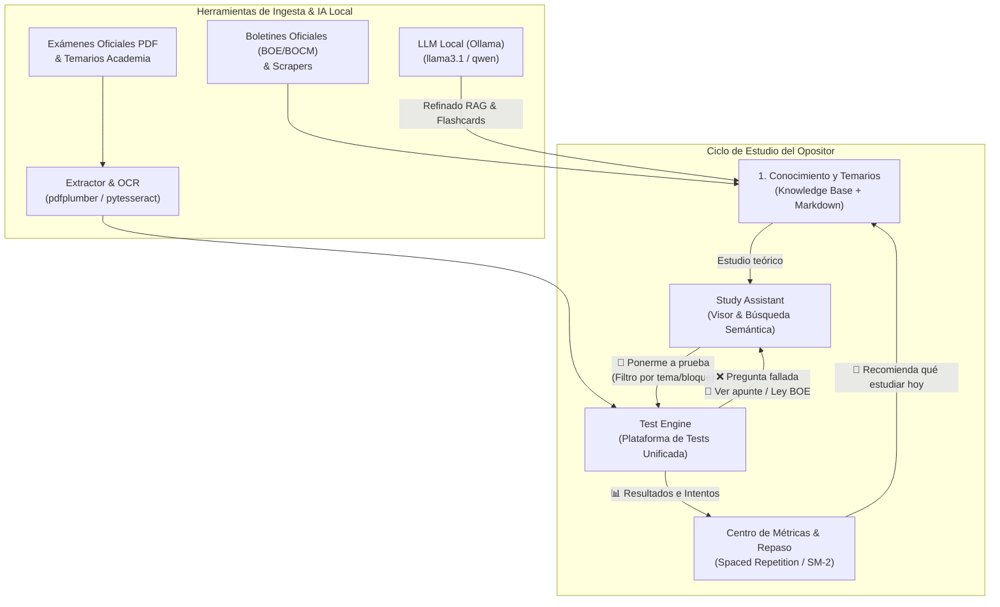
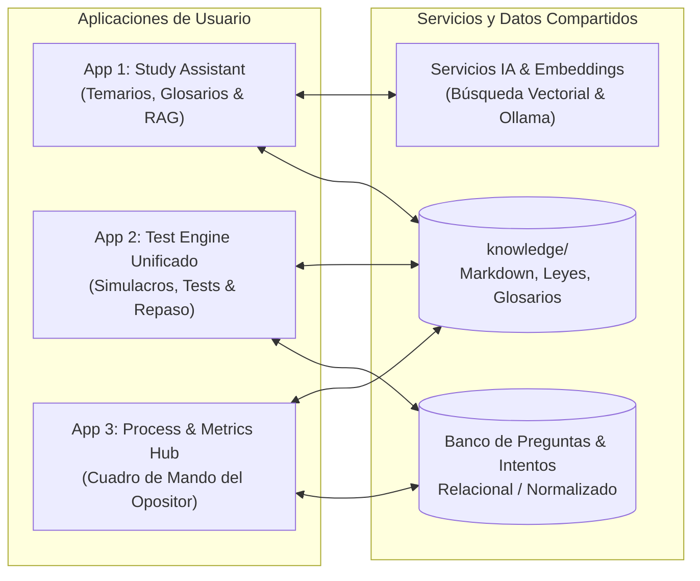
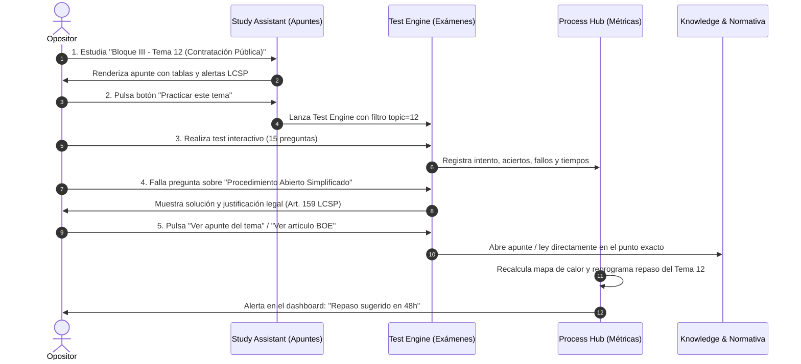

# Visión Global del Sistema PreparaOpos y Catálogo de Aplicaciones

Este documento define la **visión funcional y arquitectónica integral del ecosistema PreparaOpos**, detallando las características del sistema global, las aplicaciones que lo componen (actuales y planificadas), sus interacciones cruzadas y los requisitos técnicos que determinarán la pila tecnológica óptima para su modernización y unificación.

---

## 1. Visión y Características del Sistema Global

**PreparaOpos** es una plataforma integral de autoaprendizaje, evaluación y gestión del conocimiento diseñada específicamente para opositores a cuerpos superiores tecnológicos de la administración pública española (**AGE: A1 TIC, A2 GSI, C1 TAI**; **Comunidad de Madrid**; y **Administración Local**).

El sistema cubre el ciclo vital completo del opositor mediante 4 pilares interconectados:

### Características Globales del Sistema

1. **Local-First & Privacidad Absoluta:**
   - La plataforma debe funcionar al 100% en local sin depender obligatoriamente de conexión a internet ni de servicios de pago en la nube.
   - Todo el temario y las bases de datos residen en la máquina del usuario.
2. **Sincronización Multidispositivo Flexible (Portátil $\leftrightarrow$ Móvil/Tablet):**
   - El estudio teórico y la resolución intensiva de supuestos prácticos se realizan habitualmente en el portátil.
   - La realización de tests rápidos, repaso de preguntas falladas y lectura de resúmenes debe poder hacerse cómodamente desde el móvil o la tablet (en el sofá, transporte público o biblioteca), sincronizando el progreso con el equipo principal.
3. **Trazabilidad Bidireccional Total:**
   - Cada pregunta de test está etiquetada con su cuerpo, convocatoria, bloque, tema oficial y fundamento legal.
   - Desde cualquier pregunta se puede saltar con un clic al tema teórico correspondiente o al artículo legal en `knowledge/`.
   - Desde cualquier tema teórico se puede pulsar *"Hacer test de este tema"* para comprobar el grado de asimilación.
4. **Ingesta Continua y Banco de Preguntas Unificado:**
   - Capacidad de ingerir nuevos exámenes oficiales conforme se publican convocatorias (mediante pipelines de extracción PDF/OCR).
   - Fusión de los diferentes bancos históricos (+10.300 preguntas de PreparaTIC + exámenes oficiales AGE 2016-2024 + exámenes de la Comunidad de Madrid).
5. **Inteligencia de Repaso Progresivo:**
   - Evolución desde un histórico básico de aciertos/fallos hacia algoritmos de repetición espaciada (SM-2 / Anki) y mapas de calor temáticos que prioricen automáticamente los temas con menor tasa de acierto.

---

## 2. Catálogo de Aplicaciones y Módulos del Sistema

El ecosistema se estructura en torno a las siguientes aplicaciones y subsistemas funcionales:

---

### App 1: Study Assistant (Visor y Estudio del Temario)

*Estado actual: Implementado en PHP 8.2 OOP en `apps/studyassistant/`.*

#### Propósito:
Es la herramienta de estudio intensivo del temario teórico, guías de supuestos prácticos y glosarios normativos.

#### Funcionalidades Clave:
- **Visor de Documentación Técnica:** Renderizado enriquecido de temas en Markdown con soporte para:
  - Fórmulas matemáticas y criptográficas en $\LaTeX$ (MathJax / KaTeX).
  - Diagramas de arquitectura, flujo y secuencia dinámicos (Mermaid.js).
  - Tabla de Contenidos (TOC) jerárquica flotante y colapsable (H2 a H4).
  - Alertas normativas de estilo GitHub (NOTE, IMPORTANT, WARNING, CAUTION).
- **Procesos y Temarios Disponibles:**
  - **AGE A2 GSI:** Bloques I a IV (91 temas) + Supuesto Práctico (metodología, análisis funcional, arquitectura técnica, servicios comunes, seguridad ENS/OWASP, casos resueltos y defensa ante tribunal) + Catálogo de convocatorias (2003-2025).
  - **Comunidad de Madrid:** Perfiles de Administración Digital (P01 Consultor SI/IA, P04 Ingeniero Desarrollo, P06 Innovación).
  - **Ayuntamiento de Majadahonda.**
- **Búsqueda Híbrida Inteligente:**
  - Búsqueda por facetas: por proceso, bloque, perfil y etiquetas.
  - Búsqueda semántica vectorial local: consulta mediante lenguaje natural usando embeddings locales (`SentenceTransformers`) sin enviar datos a la nube.
- **Fuentes y Glosarios Integrados:**
  - Acceso directo a 54 normas consolidadas en formato estructurado (BOE).
  - Glosario de más de 500 siglas TIC, guías CCN-STIC, referencias de leyes y patrones de diseño.
- **Asistente de Ingesta RAG:** Stepper para subir PDFs de temarios o normativas, extraer texto con PyMuPDF y refinarlos con LLMs locales (Ollama).

---

### App 2: Test Engine (Plataforma Unificada de Tests y Evaluación)

*Estado actual: Concurrencia de 3 soluciones (`apps/preparadortai` en PHP/MariaDB, `apps/tests_preparatic` con V3 Vue 3 y V2 Gentelella, y extractor en `imports/age_a2_gsi`). Objetivo: Unificación definitiva.*

#### Propósito:
Motor central de práctica, simulacros cronometrados, entrenamiento focalizado y evaluación continua.

#### Banco de Preguntas Agrupado:
- **+10.300 preguntas PreparaTIC** (catalogadas por bloques A1/A2/B1-B4, temas 1 a 132 y convocatorias históricas).
- **Exámenes oficiales completos con plantilla de soluciones:** AGE GSI Libre 2024, AGE TAI 2023-2024, convocatorias históricas AGE 2016-2019, Junta de Andalucía, Ayuntamiento de Madrid, etc.
- **Control de incidencias:** Preguntas anuladas por tribunal, erratas reportadas y justificación motivada de la respuesta correcta.

#### Funcionalidades Clave:
- **Modos de Examen y Entrenamiento:**
  1. *Simulacro Oficial:* 100 preguntas + 5 de reserva, cronómetro regresivo oficial (100-120 minutos), distribución reglamentaria de temas y penalización oficial ($Nota = A - \frac{F}{3}$).
  2. *Test Ponderado por Relevancia:* Generación de test con mayor probabilidad de aparición para temas históricamente más preguntados en las últimas convocatorias.
  3. *Test por Bloque o Tema Específico:* Filtro directo para afianzar el tema recién estudiado en Study Assistant.
  4. *Modo Refuerzo (Bolsa de Falladas y Dudosas):* Generación de tests compuestos exclusivamente por preguntas falladas en intentos anteriores o marcadas para revisión.
  5. *Modo Contrarreloj / Ráfaga:* Preguntas rápidas de repaso con feedback inmediato.
- **Interactividad Durante el Test:**
  - Opción de responder en "Modo Examen" (solución al finalizar) o "Modo Práctica" (explicación inmediata al contestar cada pregunta).
  - Descarte interactivo de opciones (tachar opciones que se saben falsas).
  - Marcar pregunta para revisión antes de entregar.
- **Feedback Formativo y Conexión con `knowledge/`:**
  - Al revisar cualquier pregunta, además de la justificación técnica, se muestra el botón:
    - `📖 Leer tema relacionado`: Abre el apunte Markdown correspondiente en Study Assistant.
    - `📜 Consultar articulado`: Abre la ley y artículo citado de `knowledge/sources/normativa/`.

---

### App 3: Process & Metrics Hub (Centro de Mando del Opositor)

*Estado actual: Métricas básicas repartidas entre IndexedDB de PreparaTIC V3, estadísticas PHP de Preparador TAI y Dashboard de Study Assistant.*

#### Propósito:
Cuadro de mandos unificado que responde a las dos preguntas clave del opositor: **"¿Cómo voy?"** y **"¿Qué debo estudiar hoy?"**.

#### Funcionalidades Clave:
- **Progreso del Temario:**
  - Porcentaje de cobertura de lectura y repaso por bloque y proceso.
  - Estados por tema: *Pendiente*, *Leído*, *Resumido*, *En Repaso*, *Dominado*.
- **Mapa de Calor de Rendimiento:**
  - Visualización gráfica de tasa de acierto por tema y bloque temático.
  - Identificación visual automática de "puntos ciegos" (temas con bajo porcentaje de acierto o muchas convocatorias sin repasar).
- **Motor de Repetición Espaciada Progresiva:**
  - *Fase 1:* Repaso cíclico de preguntas erradas.
  - *Fase 2:* Algoritmo de intervalos crecientes (SM-2 / Anki modificado para tests): programa la fecha del próximo test de repaso en función del historial de aciertos continuados.
- **Historial Global de Simulacros:**
  - Gráfica temporal de evolución de puntuaciones respecto al corte estimado de la oposición.

---

### App 4 (Herramientas y Pipelines): Ingesta, Extracción y Curación

*Estado actual: Scripts independientes en `imports/age_a2_gsi/extractor/`, `tools/apuntes-gsi/` y `services/knowledge/`.*

#### Propósito:
Herramientas de soporte y automatización para mantener la base de conocimiento y el banco de preguntas permanentemente actualizados.

#### Funcionalidades Clave:
- **Extractor de Exámenes Oficiales:** Pipeline Python (`pdfplumber` + `pytesseract`) para parsear automáticamente PDFs oficiales de examen y plantillas de respuestas a estructuras de datos JSON/SQL limpias.
- **Monitoreo y Scraper de Normativa (BOE/BOCM):** Actualización de leyes y detección de reformas legislativas que puedan invalidar preguntas existentes.
- **Generador de Flashcards y Preguntas con LLM:** Generación de preguntas tipo test a partir de resúmenes de temas nuevos mediante inferencia local con Ollama.

---

## 3. Matriz de Flujos Cruzados entre Aplicaciones

---

## 4. Arquitectura Decidida

> [!IMPORTANT]
> La decisión arquitectónica completa está formalizada en **ADR-0001** (`0001-arquitectura-nueva-generacion.md`). A continuación se resume cómo mapea al catálogo de aplicaciones de este documento.

### Mapeo Aplicaciones → Servicios

| Aplicación (Sección 2) | Servicio en la nueva arquitectura | Notas |
| :--- | :--- | :--- |
| **App 1: Study Assistant** | `apuntes-service` | Migración de PHP 8.2 → FastAPI + Jinja2 + htmx. Incluye búsqueda semántica con `sqlite-vec` (sustituye `services/embeddings`) y asistente de ingesta RAG con Ollama (sustituye `services/knowledge`). |
| **App 2: Test Engine** | `tests-service` | Unificación de `preparadortai` (PHP/MariaDB) + `tests_preparatic` (Vue 3 SPA) en un solo servicio FastAPI con banco de preguntas normalizado en SQLite. |
| **App 3: Process & Metrics Hub** | `tests-service` (subsistema de estadísticas) | Las métricas y progreso se integran como módulo del dominio de `tests-service`, ya que dependen directamente de los datos de intentos y sesiones. |
| **App 4: Ingesta y Curación** | Repartido: extractores → scripts CLI, ingesta → `apuntes-service`, CRUD preguntas → `tests-service` | Los pipelines de extracción se mantienen como scripts independientes. Las funciones de curación se integran en el servicio correspondiente. |
| **Enlazador (Trazabilidad)** | `linking-service` | Servicio nuevo que resuelve la trazabilidad bidireccional pregunta ↔ tema (tabla `question_topic_links`). Depende de los otros dos vía HTTP. |

### Distribución Independiente

El requisito confirmado de poder ceder piezas por separado (ej. visor de apuntes al grupo PreparaTIC sin el banco de preguntas) se cumple porque cada servicio tiene su propia base SQLite y su propio `Dockerfile`. El `linking-service` solo se despliega cuando se desea la suite completa.

### Gateway (Nginx)

Cuando los 3 servicios se ejecutan juntos como suite completa, un **reverse proxy Nginx** unifica las rutas bajo un único puerto:
- `/apuntes/*` → `apuntes-service`
- `/tests/*` → `tests-service`
- `/links/*` → `linking-service`

Al distribuir un servicio por separado, simplemente no se incluye el proxy — el servicio sirve directamente en su propio puerto.

### Paquete Compartido: `libs/ai_providers`

La IA explicadora (usada tanto en apuntes como en tests) se empaqueta como librería Python editable en `libs/ai_providers/` con `pyproject.toml` propio. Cada servicio la instala con `pip install -e ../../libs/ai_providers`. Esto evita la duplicación de código entre servicios — problema ya identificado con el normalizador Markdown entre PHP y Python.

### Stack Tecnológico

Python 3.11 · FastAPI · Jinja2 + htmx + Alpine.js · Tailwind CLI standalone · SQLite (WAL) + sqlite-vec · Ollama · sentence-transformers · Docker Compose · Nginx

Ver ADR-0001 §5 para la tabla completa con justificaciones.

---

## 5. Plan de Migración

Se adopta el patrón ***strangler fig***: cada fase mantiene las aplicaciones PHP existentes operativas hasta que su equivalente en el nuevo sistema esté verificado.

| Fase | Alcance | Apps que se retiran |
| :--- | :--- | :--- |
| **0** | Esqueleto `apuntes-service` — solo lectura (visor + búsqueda semántica) | Ninguna |
| **1** | `tests-service` — migración completa de datos y tests funcionales | — |
| **2** | `apuntes-service` — escritura (ingesta, edición, borrado de apuntes) | `services/knowledge` |
| **3** | `tests-service` — CRUD completo de preguntas | `apps/preparadortai`, `apps/studyassistant` |
| **4** | `linking-service` — trazabilidad bidireccional | `suggest_topic_links.py`, `topic_links.php` |
| **5** | Backlog futuro: SM-2, PWA offline, flashcards, simulacros adaptativos | — |

Ver ADR-0001 §6 para el detalle completo.

---

*Documento actualizado para alinearse con ADR-0001 (`0001-arquitectura-nueva-generacion.md`).*
