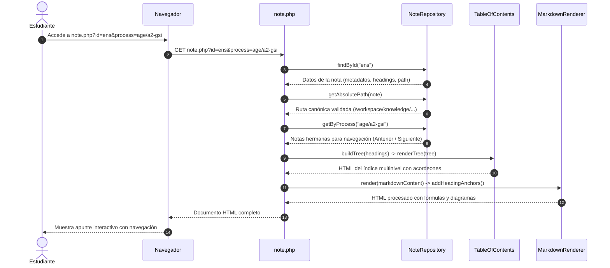
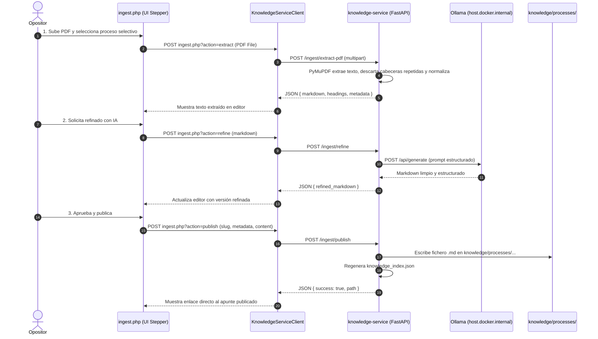

# Arquitectura de Study Assistant

Documento técnico descriptivo de la arquitectura de software, infraestructura, flujo de datos y componentes de **Study Assistant**, el subsistema de consulta, estudio, ingesta asistida y búsqueda semántica sobre la base de conocimiento Markdown de **preparaopos**.

---

## 1. Introducción y Objetivos

**Study Assistant** es una aplicación web desacoplada, rápida y orientada al opositor para la exploración, ingesta y estudio de los temas y apuntes estructurados en Markdown (`knowledge/**/*.md`).

Sus objetivos clave son:
1. **Navegación e indexación estructurada:** Permitir localizar rápidamente apuntes por proceso de oposición, temas oficiales, perfiles y etiquetas.
2. **Lectura enriquecida sin dependencias pesadas:** Renderizar apuntes con soporte para fórmulas matemáticas ($\LaTeX$ mediante MathJax), diagramas dinámicos (Mermaid.js), bloques de examen interactivos y tabla de contenidos (TOC) multinivel y colapsable.
3. **Búsqueda híbrida (Léxica + Semántica):** Ofrecer filtrado instantáneo por metadatos y palabras clave en servidor, y búsqueda vectorial por significado basada en modelos locales de Embeddings, sin depender de servicios de pago en la nube ni exponer claves externas.
4. **Ingesta y normalización asistida por IA:** Carga interactiva de PDFs de temarios, extracción de texto con PyMuPDF, refinado asistido por LLMs locales (Ollama) y publicación automática en la base de conocimiento.
5. **Interoperabilidad con el ecosistema preparaopos:** Conectar los temas leídos con simulacros y tests activos en la aplicación complementaria **preparadortai**.

---

## 2. Vista General de la Arquitectura

Study Assistant adopta una **arquitectura orientada a objetos (OOP)** en PHP 8.2 con autocargador nativo PSR-4, complementada con microservicios auxiliares en Python (FastAPI):

```mermaid
flowchart TD
    subgraph Cliente["Cliente (Navegador Web)"]
        UI["Interfaz de Usuario (HTML5 / CSS3 / Stepper)"]
        JS_Search["semantic-search.js (Fetch API)"]
        Mermaid_Lib["Mermaid.js v10 (Diagramas ESM)"]
        MathJax_Lib["MathJax v3 (Fórmulas LaTeX)"]
    end

    subgraph App_Web["Contenedor: preparaopos-studyassistant-web (PHP 8.2)"]
        subgraph Endpoints_Web["Controladores / Endpoints Web (apps/studyassistant/)"]
            IndexController["index.php (Catálogo y KPIs)"]
            NoteController["note.php (Visor con TOC y Práctica)"]
            IngestController["ingest.php (Stepper Ingesta PDF / LLM)"]
            SearchProxy["search.php (Proxy Búsqueda Semántica)"]
            AssetServer["asset.php (Servidor Seguro de Recursos)"]
        end

        subgraph Capa_Compatibilidad["Capa de Compatibilidad / Fachadas (includes/)"]
            Autoloader["autoload.php (Autocargador Nativo PSR-4)"]
            KnowledgeFacade["knowledge.php (Fachada funciones sa_*)"]
            MarkdownFacade["markdown.php (Fachada funciones sa_*)"]
        end

        subgraph Core_OOP["Núcleo OOP (src/)"]
            NoteRepo["StudyAssistant\\Knowledge\\NoteRepository<br>(Singleton, Caché, Búsqueda O(1), Path Traversal)"]
            MDRenderer["StudyAssistant\\Markdown\\MarkdownRenderer<br>(MathJax, Mermaid, Quiz Cards, Tablas)"]
            TOCService["StudyAssistant\\Navigation\\TableOfContents<br>(Árbol Jerárquico h2-h4, Acordeones)"]
            DashMetrics["StudyAssistant\\Dashboard\\DashboardMetrics<br>(Agregación de KPIs, Resúmenes de Proceso)"]
            ServiceClient["StudyAssistant\\Service\\KnowledgeServiceClient<br>(Cliente HTTP/cURL tipado)"]
        end
    end

    subgraph Microservicios_Python["Microservicios Auxiliares (FastAPI / Python 3.11)"]
        Vector_Service["preparaopos-embeddings (Puerto 8091)<br>Modelo: paraphrase-multilingual-MiniLM-L12-v2<br>NumPy (Cálculo Coseno Matricial en CPU)"]
        Knowledge_Service["preparaopos-knowledge-service (Puerto 8100)<br>Extracción PyMuPDF + Refinado Ollama"]
    end

    subgraph Almacenamiento_Persistente["Almacenamiento en Disco (Volúmenes)"]
        Knowledge_MD["knowledge/**/*.md (Base de Conocimiento)"]
        Index_JSON["data/knowledge_index.json (Índice Léxico)"]
        Semantic_Chunks["data/semantic_chunks.json (Fragmentos)"]
        Semantic_Embeddings["data/semantic_embeddings.npy (Vectores)"]
    end

    subgraph App_Externa["Ecosistema Preparadortai"]
        PreparadorTAI["preparadortai (Entrenador de Tests / MariaDB)"]
    end

    %% Relaciones Cliente
    UI --> IndexController
    UI --> NoteController
    UI --> IngestController
    JS_Search --> SearchProxy
    UI --> AssetServer
    UI --> Mermaid_Lib
    UI --> MathJax_Lib

    %% Relaciones Endpoints -> Core OOP
    IndexController --> NoteRepo
    IndexController --> DashMetrics
    NoteController --> NoteRepo
    NoteController --> MDRenderer
    NoteController --> TOCService
    IngestController --> ServiceClient
    IngestController --> NoteRepo
    IngestController --> MDRenderer
    SearchProxy --> ServiceClient
    AssetServer --> NoteRepo

    %% Relaciones Fachadas -> Core OOP
    KnowledgeFacade -.-> NoteRepo
    MarkdownFacade -.-> MDRenderer
    Autoloader --> Core_OOP

    %% Relaciones Core OOP -> Almacenamiento
    NoteRepo --> Index_JSON
    NoteRepo --> Knowledge_MD

    %% Relaciones Microservicios
    ServiceClient -->|HTTP Ingest / Refine / Publish| Knowledge_Service
    ServiceClient -->|HTTP GET /search| Vector_Service
    Vector_Service --> Semantic_Chunks
    Vector_Service --> Semantic_Embeddings

    %% Integración Externa
    NoteController -.->|"Enlace de Práctica (?topics=...)"| PreparadorTAI
```



---

## 3. Componentes del Sistema

### 3.1. Núcleo Orientado a Objetos (`src/`)

El sistema utiliza el namespace raíz `StudyAssistant\` respaldado por un autocargador nativo PSR-4 (`includes/autoload.php`):

* **`StudyAssistant\Knowledge\NoteRepository`:**
  * **Patrón Singleton**: Instancia única accesible vía `NoteRepository::getInstance()`.
  * **Caché en memoria**: Carga `data/knowledge_index.json` una sola vez por petición.
  * **Búsqueda y filtrado O(1)**: `findById($id)`, `filter($query, $tag, $process, $status)`, `getByProcess($process)`.
  * **Seguridad Path Traversal**: `getAbsolutePath(array $note)` valida estrictamente con `realpath()` que la ruta resida dentro de `knowledge/`.
  * **Normalización de temas de práctica**: `normalizePracticeTopics($note)` extrae temas desde `practice.topics`, `tags` u `official_topic`.
  * **Ordenación secuencial**: `sortSequentially(&$notes)` ordena temas por numeración oficial natural ("Tema 1", "Tema 2", ..., "Tema 10").
* **`StudyAssistant\Markdown\MarkdownRenderer`:**
  * Motor nativo de renderizado Markdown sin dependencias externas pesadas.
  * **Preservación matemática**: Detecta `$inline$` y `$$bloque$$`, protegiéndolos mediante marcadores seguros para su posterior hidratación por MathJax v3.
  * **Diagramas Mermaid**: Transforma bloques ```` ```mermaid ```` en etiquetas `<pre class="mermaid">` con autodetección de tipos (mindmap, graph, sequence, etc.).
  * **Tarjetas tipo test (Quiz cards)**: Detecta preguntas formateadas (`Pregunta N. ... A) B) C) D) Respuesta correcta: X`) y las transforma en componentes interactivos con respuesta desplegable en acordeón.
  * **Tablas GFM y Callouts**: Procesa tablas Markdown con saltos de línea y notas `<aside class="note">`.
  * **Reescritura segura de recursos**: Reescribe enlaces de imágenes relativas para ser servidas vía `asset.php`.
* **`StudyAssistant\Navigation\TableOfContents`:**
  * **Construcción del árbol**: `buildTree(array $headings)` procesa listas planas de encabezados (`h2` a `h4`) y las organiza en un árbol jerárquico recursivo.
  * **Renderizado accesible**: `renderTree(array $tree)` emite marcado `<details open class="toc-details"><summary>` para niveles con subsecciones y enlaces directos con ancla `#`.
* **`StudyAssistant\Dashboard\DashboardMetrics`:**
  * Calcula métricas objetivas para el Dashboard (total de apuntes, revisados, borradores, procesos, etiquetas).
  * Genera los resúmenes agregados por proceso selectivo para el Process Hub.
  * Construye chips de filtros activos con URLs de eliminación dinámica.
* **`StudyAssistant\Service\KnowledgeServiceClient`:**
  * Cliente cURL tipado para interactuar con los microservicios de Python (`knowledge-service:8000` y `embeddings:8000`).
  * Métodos: `extractPdf()`, `refine()`, `publish()`, `get()`, `postJson()`, `postMultipart()`.
  * Manejo unificado de errores y timeouts defensivos (hasta 300s para llamadas a LLMs locales).

---

### 3.2. Capa de Compatibilidad / Fachadas (`includes/`)

Para mantener **100% de compatibilidad hacia atrás** con scripts históricos, tests y herramientas CLI:
* **`includes/autoload.php`**: Autocargador PSR-4 nativo de alto rendimiento.
* **`includes/knowledge.php`**: Contiene funciones procedurales `sa_*` (`sa_load_index`, `sa_find_note_by_id`, `sa_note_absolute_path`, `sa_filter_notes`, `sa_collect_unique`, `sa_format_process_title`, `sa_sort_notes_sequentially`, `build_nested_toc`, `render_nested_toc`) que actúan como delegados directos hacia `NoteRepository` y `TableOfContents`.
* **`includes/markdown.php`**: Contiene funciones procedurales `sa_render_markdown`, `sa_inline_markdown`, `add_heading_anchors`, etc., que delegan en `MarkdownRenderer`.

---

### 3.3. Controladores y Vistas Web (`apps/studyassistant/`)

* **`index.php` (Dashboard y Catálogo):**
  * Vista principal con KPIs globales, Process Hub interactivo, selector de vista (Cuadrícula / Lista compacta) y filtros multi-criterio.
* **`note.php` (Visor de Apuntes):**
  * Renderiza el contenido del apunte, breadcrumbs de navegación, barra lateral con TOC dinámico anidado, metadatos y botón de acción *"📝 Ponerme a prueba"*.
* **`ingest.php` (Asistente de Ingesta):**
  * Stepper interactivo de 4 pasos (Cargar Documento -> Extracción & Análisis -> Revisión & Edición -> Publicado).
  * Proxies AJAX para extracción con PyMuPDF, previsualización en vivo, refinado con Ollama y publicación en disco.
* **`search.php` (Proxy de Búsqueda Semántica):**
  * Endpoint JSON que reenvía consultas al microservicio `embeddings:8000` y enriquece los resultados con URLs directas con anclas (`note.php?id=ID#anchor`).
* **`asset.php` (Servidor Seguro de Recursos):**
  * Sirve imágenes asociadas a los apuntes validando estrictamente contra ataques de *Path Traversal*.

---

## 4. Flujos Operativos y Diagramas de Secuencia

### 4.1. Consulta de Apunte con Navegación Secuencial y TOC



### 4.2. Ingesta y Refinado Asistido por LLM



---

## 5. Pruebas y Verificación

El subsistema cuenta con una suite de pruebas automatizadas en [`apps/studyassistant/tests/test_studyassistant.php`](file:///c:/repositories/preparaopos/apps/studyassistant/tests/test_studyassistant.php):
- **Ejecución**: `docker exec preparaopos-studyassistant-web php /workspace/apps/studyassistant/tests/test_studyassistant.php`
- **Resultados**: **65 pruebas unitarias superadas, 0 fallos**.
- **Cobertura**:
  - Autocargador PSR-4 (resolución de namespaces).
  - `NoteRepository` (Singleton, búsquedas O(1), filtros multi-criterio, sorting secuencial, bloqueo de Path Traversal).
  - `MarkdownRenderer` (fórmulas MathJax inline y bloque, diagramas Mermaid, quiz cards, tablas GFM, anclas).
  - `TableOfContents` (jerarquía de encabezados h2-h4, acordeones colapsables).
  - `DashboardMetrics` (conteos, resúmenes por proceso, chips de filtros).
  - `KnowledgeServiceClient` (configuración de URLs y timeouts).
  - Fachadas de compatibilidad `sa_*` (100% compatibles hacia atrás).
