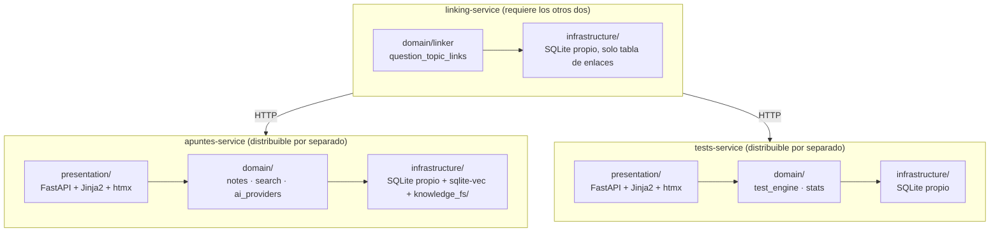

# ADR-0001: Propuesta de nueva Arquitectura

- **Estado:** Aceptado
- **Fecha:** 25 de septiembre de 2026
- **Documentos de referencia:** `ARCHITECTURE.md`, `SISTEMA_Y_APLICACIONES.md`, `ESPECIFICACION_REQUISITOS_Y_ARQUITECTURA.md`

---

## 1. Contexto

El sistema actual (`apps/preparadortai` en PHP procedimental, `apps/studyassistant` en PHP 8.2 OOP, `services/embeddings` y `services/knowledge` en Python/FastAPI, MariaDB) presenta fricciones documentadas en `ARCHITECTURE.md` §5:

- Fragmentación de lenguajes (PHP vs Python), con menor comodidad de la desarrolladora en PHP.
- Dos aplicaciones web en puertos distintos sin sesión ni navegación compartida.
- Persistencia dispersa en 4 motores distintos (MariaDB, ficheros Markdown, JSON de índice, `.npy` de vectores).
- Duplicación de lógica de normalización de Markdown entre PHP y Python.

Los documentos de partida proponían una unificación total en una SPA (React/Vue + Vite) sobre un backend FastAPI único, con base de datos SQLite o PostgreSQL+pgvector. Tras discusión, esa propuesta se ha revisado en varios puntos — ver §3.

---

## 2. Restricciones y factores de decisión

| Factor | Valor |
|---|---|
| Coste de APIs externas | Cero de partida; adaptadores a IA de pago se dejan como extensión futura, no requisito inicial |
| GPU disponible | Ninguna (Intel Iris Xe) — descarta modelos locales grandes o exigentes |
| Equipo | Una desarrolladora, cómoda en Python y en C/C++ a bajo nivel; no cómoda en PHP |
| RBAC / multiusuario | No aplica — sistema de un único usuario. Se aplicará mínimo privilegio a nivel de infraestructura, no roles de aplicación |
| Observabilidad | Logging estructurado a fichero es suficiente por ahora; sin stack de monitorización dedicado |
| **Distribución independiente de piezas** | **Requisito real confirmado:** debe ser posible ceder/desplegar el visor de apuntes sin el banco de preguntas (p. ej., al grupo PreparaTIC), o viceversa |
| Prioridad de movilidad/sincronización offline | Baja — no es bloqueante para el objetivo principal (aprobar oposiciones) |
| Prioridad de RFF documentados (SM-2, simulacros adaptativos, flashcards, detección de normativa derogada) | Baja — deseables, no urgentes |

---

## 3. Opciones consideradas

### Opción A — Monolito modular en un único proceso FastAPI
Todo el dominio (apuntes, tests, enlazador, búsqueda semántica) como módulos Python dentro de un solo proceso, con capas internas (presentación / dominio / infraestructura).

- ✅ Mínima complejidad operativa; sin coste de red entre módulos.
- ❌ **No cumple el requisito de distribución independiente** — no se puede ceder solo el visor de apuntes sin llevarse también el motor de tests, porque ambos son el mismo proceso/despliegue.

### Opción B — Microservicios de grano fino (uno por función de dominio)
Un servicio por cada responsabilidad (apuntes, tests, enlazador, búsqueda semántica, estadísticas, planificador de estudio...).

- ❌ Ninguna de las funciones tiene necesidad real de escalar, desplegarse o fallar de forma independiente entre sí a ese nivel de granularidad.
- ❌ Coste de red, timeouts, trazabilidad distribuida y mantenimiento (N Dockerfiles, N puertos) sin beneficio proporcional. Es el escenario que llevó a Amazon Prime Video a revertir de microservicios a monolito en 2023 en un componente con un problema equivalente.

### Opción C — Tres servicios agrupados por límite de distribución, cada uno en capas (elegida)
Separación en `apuntes-service`, `tests-service` y `linking-service`, cada uno con su propia base de datos y desplegable de forma independiente; cada uno organizado internamente en capas (presentación / dominio / infraestructura), no como código plano.

- ✅ Cumple el requisito real de poder repartir piezas sueltas.
- ✅ La frontera de red entre servicios está justificada por una razón concreta (distribución), no por costumbre.
- ✅ Dentro de cada servicio, sin coste de red — el dominio es Python normal, testeable sin HTTP de por medio.
- ⚠️ Coste aceptado: `linking-service` depende de que los otros dos estén disponibles por HTTP para poder resolver enlaces.

---

## 4. Decisión

Se adopta la **Opción C**: tres servicios Docker, cada uno internamente organizado en capas.



### 4.1. Estructura interna de cada servicio

```
<servicio>/
├── presentation/    # Vista — FastAPI routers + plantillas Jinja2 + htmx/Alpine.js
├── domain/          # Lógica de negocio, sin dependencia de FastAPI ni HTTP
├── infrastructure/  # Acceso a datos: SQLite (SQLAlchemy), sqlite-vec, ficheros
└── Dockerfile
```

El `domain/` de cada servicio no importa nada de `presentation/` ni de FastAPI — se puede probar con `unittest` llamando directamente a sus funciones, sin levantar un servidor. Esto es lo que permite, el día que se necesite, empaquetar `domain/` como librería Python propia (`pyproject.toml` independiente) y reutilizarla desde otra aplicación sin pasar por HTTP.

### 4.2. Persistencia

Cada servicio tiene **su propia base SQLite** (modo WAL), no una compartida:

- `apuntes-service`: metadatos de notas + `sqlite-vec` para los embeddings (sustituye a `semantic_embeddings.npy` + `semantic_chunks.json` como ficheros aparte).
- `tests-service`: preguntas, intentos, sesiones (migración de `ptype`, `test_attempts`, `test_sessions` desde MariaDB).
- `linking-service`: únicamente la tabla `question_topic_links`.

Bases de datos separadas físicamente es lo que hace real la distribución independiente — si se comparte `apuntes-service` con PreparaTIC, no hay ningún fichero que contenga también el historial de exámenes propio.

### 4.3. Adaptadores de IA (sustituye a un "servicio de integraciones")

```python
class LLMProvider(Protocol):
    def explain(self, text: str, context: str) -> str: ...

class OllamaProvider(LLMProvider): ...      # por defecto, hoy
class GeminiProvider(LLMProvider): ...      # API gratuita, próxima
class OpenAIProvider(LLMProvider): ...      # de pago, futuro — bring your own key
```

Vive dentro de `apuntes-service/domain/ai_providers/`. Añadir un proveedor nuevo no requiere ni un servicio nuevo ni tocar el resto del dominio. El mismo patrón (`SyncAdapter`) se reserva para integraciones tipo Notion/Obsidian si se abordan más adelante.

### 4.4. Trabajo en segundo plano

El refinado LLM por lotes (cientos de documentos) no debe bloquear peticiones web. Se resuelve con un worker simple (`arq`/`huey`, o mantener el script CLI actual) dentro de `apuntes-service` — no es un servicio nuevo, es un segundo proceso *del mismo servicio* para trabajo largo.

### 4.5. Piezas en C/C++

No se crea ningún servicio nuevo por este motivo. Si en el futuro se implementa un módulo concreto en C/C++ (p. ej. un motor de corrección), se integra como extensión nativa (bindings `pybind11`) dentro del `domain/` del servicio que corresponda (`tests-service` para un motor de corrección), sin alterar el número de servicios.

---

## 5. Stack tecnológico

| Capa | Tecnología | Justificación |
|---|---|---|
| Backend | Python 3.11, FastAPI, Uvicorn | Ya usado y dominado; consolida la lógica ya escrita en `services/` |
| Validación / ORM | Pydantic v2 + SQLAlchemy 2.0 (o SQLModel) | Tipado fuerte, menos código repetitivo que `mysqli` |
| Base de datos | SQLite (WAL) + extensión `sqlite-vec` por servicio | Un fichero por servicio, portable, sin servidor de BD que mantener; cumple exportación zero-cloud |
| Vistas | Jinja2 + htmx + Alpine.js | Sin pipeline de compilación; suficiente para contenido y formularios; PWA ligera se añade encima solo si se retoma la prioridad móvil |
| CSS | Tailwind CLI standalone | Sin arrastrar Node.js/Vite al proyecto |
| Embeddings | `sentence-transformers` (sin cambios) | Ya funciona, sin razón para sustituirlo |
| LLM local | Ollama, vía `httpx` desde `apuntes-service` | Ya es local y gratuito |
| Contenedores | Docker Compose, 3 servicios de aplicación (+ base de datos si se prefiere gestor externo) | Empaquetado reproducible; no implica microservicios de grano fino |
| Logs | `logging` de Python a fichero rotado por servicio | Suficiente para trazabilidad de errores hoy; stack de observabilidad queda fuera de alcance |
| Tests | `unittest` + `TestClient` de FastAPI | Continúa la convención ya establecida en `tests/` |
| CI | GitHub Actions (sin cambios) | Ya operativo |

---

## 6. Plan de migración por fases

Patrón *strangler fig*: cada fase mantiene el sistema PHP existente operativo hasta que su equivalente en el sistema nuevo esté probado. Nunca un corte total.

| Fase | Alcance | Estado | Qué se retira al terminar |
|---|---|---|---|
| **0** | Esqueleto de `apuntes-service` (capas + Docker). Solo lectura: visor de apuntes y búsqueda semántica migrados desde PHP/`services/embeddings`. | **Verificada** | Nada aún — PHP sigue siendo la vía principal |
| **1** | Migración de datos MariaDB → SQLite de `tests-service` (`test-engine`). Lectura y realización de tests contra la base nueva. | **Verificada** | — |
| **2** | Escritura en `apuntes-service`: importar, editar, borrar apuntes (sustituye al stepper de ingesta PHP y a `services/knowledge`) | Pendiente | `services/knowledge` |
| **3** | Escritura en `tests-service`: alta/edición/baja de preguntas | Pendiente | `apps/preparadortai` |
| **4** | `linking-service` como servicio de primera clase, sustituyendo `suggest_topic_links.py` y `topic_links.php` | Pendiente | El script y el helper PHP |
| **5** | Backlog aparcado, solo si se retoma: SM-2, simulacros adaptativos, PWA offline móvil, flashcards, detección de normativa derogada | Pendiente | — |

`apps/studyassistant` (PHP) se retira al completar la Fase 2; `apps/preparadortai` (PHP) al completar la Fase 3.

---

## 7. Consecuencias

**Positivas:**
- Se cumple el requisito real de poder distribuir `apuntes-service` o `tests-service` por separado.
- Cada servicio es Python homogéneo — se cierra la fricción PHP documentada en `ARCHITECTURE.md` §5.1.
- El dominio de cada servicio es reutilizable como librería sin pasar por HTTP, dejando abierta la integración con otra app futura sin rediseñar nada.
- Persistencia unificada por servicio (SQLite + `sqlite-vec`) reduce de 4 motores de almacenamiento a 1 por servicio.

**Negativas / aceptadas conscientemente:**
- `linking-service` introduce dependencia de red real entre servicios — requiere manejar el caso en que `apuntes-service` o `tests-service` no respondan.
- Migración de datos (MariaDB → SQLite) es un punto de riesgo que requiere script de migración verificado antes de retirar MariaDB.
- Sin RBAC ni observabilidad — válido mientras el sistema sea de un único usuario en una única máquina; revisar si eso cambia.

**Explícitamente fuera de alcance por ahora:** RBAC, sincronización multidispositivo, PWA offline, SM-2, simulacros adaptativos, flashcards, detección de normativa derogada — todo en Fase 5, sin fecha comprometida.

---

## 8. Estado de Implementación y Seguimiento

A fecha de octubre de 2026, las **Fases 0 y 1** se encuentran implementadas y verificadas:

1. **`apuntes-service` (Fase 0):**
   - Servicio de lectura de apuntes y búsqueda semántica vectorial verificado.

2. **`test-engine` / `tests-service` (Fase 1):**
   - **Persistencia e Ingesta:** Base de datos SQLite unificada (`test_engine.sqlite`, modo WAL) con 18.112 preguntas consolidadas (MariaDB TAI, PreparaTIC, AGE GSI 2024 con 96 ordinarias válidas y 5 reservas).
   - **Capa de Dominio:** 
     - `ScoringService`: Aritmética exacta con `Decimal` (fórmula oficial AGE $A - F/3$, escala configurable a 10, redondeo bancario/half-up configurable y suelo en 0).
     - `TestSessionService`: Gestión inmutable de orden de preguntas, autoridad de tiempos estricta en servidor (`remaining_seconds`), tratamiento de no respondidas como blancos y cierre perezoso (*lazy close*) de sesiones expiradas.
   - **Capa de Presentación:** FastAPI + Jinja2 + htmx con plantilla unificada (`question.html`), temporizador visual en cliente que redirige al cierre, feedback inline interactivo en modo práctica, ocultamiento estricto en modo examen (defensa en profundidad sin inyección del objeto de la pregunta en contexto) y hoja de resultados con desglose de opciones y justificaciones.
   - **Suite de pruebas:** 23 tests automatizados pasando al 100% (`test_scoring_service.py`, `test_session_service.py`, `test_presentation.py`).

### 8.1. Deuda Técnica y Backlog Identificado para la UI y Catálogo
Tras la verificación manual de la interfaz de `test-engine`, se registran formalmente los siguientes puntos para iteraciones posteriores:

1. **Alineación de UI/UX con aplicaciones de referencia (PreparaTIC y preparadortai):**
   - La interfaz actual es un scaffolding funcional mínimo (MVP limpio con htmx y CSS base).
   - Queda pendiente rediseñar la UI para acercarla al estilo, ergonomía y riqueza visual de las aplicaciones de referencia (**PreparaTIC** y **preparadortai**), mejorando la navegación, controles y presentación de las preguntas.
2. **Exposición del catálogo histórico completo de exámenes:**
   - Aunque la base de datos contiene más de 18.000 preguntas de diversas convocatorias históricas, la UI actual del catálogo solo expone de forma directa el examen AGE GSI 2024 (ID 53).
   - Queda pendiente mapear y habilitar en la interfaz el resto de exámenes oficiales históricos de PreparaTIC y preparadortai, así como selectores para práctica libre por bloques y temas de temario.
3. **Gateway Nginx (Cableado Operativo):**
   - Pendiente de configurar `nginx.conf` (`:8080`) enrutando `/` a `apuntes-service` y `/tests` a `test-engine` cuando ambos servicios convivan en el mismo entorno.

