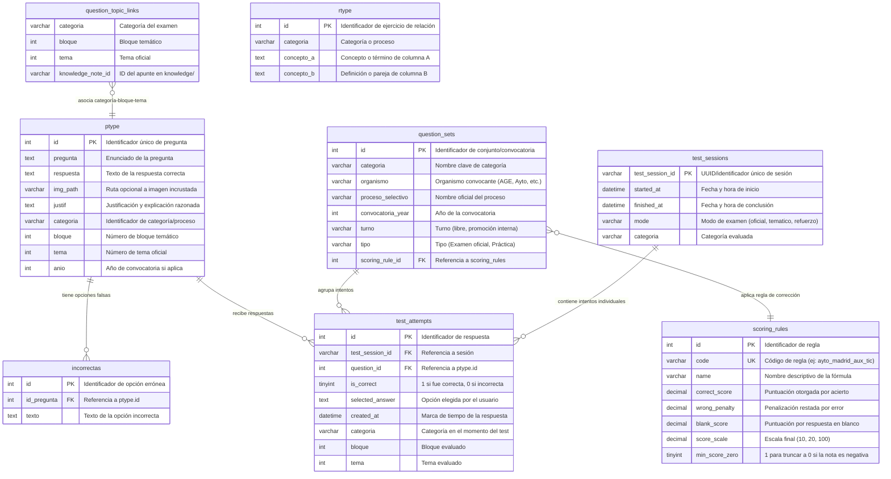

# Topología de Datos y Persistencia

**Última actualización:** 26 de septiembre de 2026  
**Estado:** Inventario del sistema actual (As-Is) — previo a migración

Este documento cataloga todos los almacenes de datos del ecosistema PreparaOpos, sus esquemas, formatos y ubicaciones. Se actualizará conforme avance la migración a la nueva arquitectura (ver `docs/adr/0001-arquitectura-nueva-generacion.md`).

---

## Índice

- [Topología de Datos y Persistencia](#topología-de-datos-y-persistencia)
  - [Índice](#índice)
  - [1. Resumen de Motores de Almacenamiento](#1-resumen-de-motores-de-almacenamiento)
  - [2. MariaDB Relacional (Preparador TAI)](#2-mariadb-relacional-preparador-tai)
    - [Conexión](#conexión)
    - [2.1. Diagrama ER Completo](#21-diagrama-er-completo)
    - [2.2. Descripción de Tablas](#22-descripción-de-tablas)
    - [2.3. Exportación y Gestión del Dump Local](#23-exportación-y-gestión-del-dump-local)
  - [3. Datos Inline en SPA (PreparaTIC V3) — Fuente Principal de Preguntas](#3-datos-inline-en-spa-preparatic-v3--fuente-principal-de-preguntas)
    - [Esquema de datos verificado](#esquema-de-datos-verificado)
    - [Datos cuantitativos verificados](#datos-cuantitativos-verificados)
  - [4. IndexedDB (PreparaTIC V3 — Solo Progreso del Usuario)](#4-indexeddb-preparatic-v3--solo-progreso-del-usuario)
  - [5. Ficheros Markdown (Knowledge Base)](#5-ficheros-markdown-knowledge-base)
  - [6. Estructuras Vectoriales e Índices (Study Assistant)](#6-estructuras-vectoriales-e-índices-study-assistant)
  - [7. CSVs de PreparaTIC (Referencia Histórica)](#7-csvs-de-preparatic-referencia-histórica)
  - [8. SQL de Exámenes Oficiales Importados](#8-sql-de-exámenes-oficiales-importados)
  - [9. Reglas de Git para Datos](#9-reglas-de-git-para-datos)
  - [10. Estado Objetivo (To-Be)](#10-estado-objetivo-to-be)
    - [Fuentes de migración para `test-engine`](#fuentes-de-migración-para-test-engine)

---

## 1. Resumen de Motores de Almacenamiento

El estado de los datos se encuentra actualmente **fragmentado en 4 motores de almacenamiento** más 2 fuentes de datos en ficheros planos pendientes de integración:

| # | Motor / Formato | Ubicación | Aplicación que lo consume | Volumen aproximado |
| :--- | :--- | :--- | :--- | :--- |
| 1 | **MariaDB 10.4** | Contenedor Docker / XAMPP local | `apps/preparadortai` (PHP) | 7 tablas, ~1.500 preguntas |
| 2 | **JS inline en SPA** | `apps/tests_preparatic/v3/index.html` (86 MB) | `apps/tests_preparatic` (V3 SPA Vue 3) | **16.673 preguntas únicas** + catálogo de 133 temas |
| 3 | **IndexedDB** (navegador) | Almacenamiento local del navegador | `apps/tests_preparatic` (V3 SPA) | Intentos, estadísticas y preferencias del usuario |
| 4 | **Ficheros Markdown** | `knowledge/**/*.md` | `apps/studyassistant` (PHP) | ~200 ficheros, 4 administraciones |
| 5 | **JSON + NumPy** | `apps/studyassistant/data/` | `services/embeddings` (Python) | 3 ficheros (índice + chunks + vectores dim. 384) |
| 6 | **CSV** (ficheros planos) | `apps/tests_preparatic/data/` | ⚠️ Referencia histórica — procedencia desconocida | 10.308 filas, 22 columnas |
| 7 | **SQL generado** | `imports/age_a2_gsi/generated/` | No integrado; requiere import manual | ~180 preguntas AGE GSI 2024 |

---

## 2. MariaDB Relacional (Preparador TAI)

### Conexión

| Parámetro | Docker | XAMPP Local |
| :--- | :--- | :--- |
| Host | `localhost` | `localhost` / `127.0.0.1` |
| Puerto | `3307` | `3306` |
| Base de datos | `preparadortai` | `preparadortai` |
| Usuario app | `preparaopos` | `root` |
| Contraseña app | `preparaopos` | *(sin contraseña o la configurada)* |

### 2.1. Diagrama ER Completo



### 2.2. Descripción de Tablas

| Tabla | Propósito | Claves / Relaciones |
| :--- | :--- | :--- |
| `ptype` | Tabla principal de preguntas tipo test. Almacena enunciado, respuesta correcta, justificación, imagen opcional, categoría, bloque, tema y año. | PK: `id` |
| `incorrectas` | Opciones de respuesta falsas vinculadas a una pregunta. Número variable de opciones por pregunta. | FK: `id_pregunta` → `ptype.id` |
| `rtype` | Ejercicios de emparejar conceptos (columna A ↔ columna B). Independiente de las preguntas tipo test. | PK: `id` |
| `test_sessions` | Cabecera de cada sesión de examen realizada por el usuario. Registra inicio, fin, modo y categoría. | PK: `test_session_id` (UUID) |
| `test_attempts` | Detalle transaccional: cada respuesta emitida por el usuario durante un test, registrada en tiempo real. | FK: `test_session_id`, `question_id` → `ptype.id` |
| `question_sets` | Definición de convocatorias y conjuntos de examen con su organismo, año, turno y regla de corrección. | FK: `scoring_rule_id` → `scoring_rules.id` |
| `scoring_rules` | Parámetros de corrección: puntuación por acierto, penalización por fallo, escala y truncamiento. | UK: `code` |
| `question_topic_links` | Mapeo relacional de preguntas con bloques y temas teóricos de `knowledge/`. | Compuesta: `categoria` + `bloque` + `tema` |

### 2.3. Exportación y Gestión del Dump Local

El dump real de la base de datos **no se versiona en Git**. Se genera localmente desde la instancia XAMPP/MariaDB y se coloca en:

```text
db/local/001_preparadortai_dump.sql
```

**Comando de exportación** (desde la raíz del repositorio):

```powershell
# Sin contraseña en root:
& "C:\xampp\mysql\bin\mysqldump.exe" -u root --default-character-set=utf8mb4 --databases preparadortai --result-file=".\db\local\001_preparadortai_dump.sql"

# Con contraseña:
& "C:\xampp\mysql\bin\mysqldump.exe" -u root -p --default-character-set=utf8mb4 --databases preparadortai --result-file=".\db\local\001_preparadortai_dump.sql"
```

> [!WARNING]
> No usar redirección con `>` en PowerShell para generar el dump. Windows PowerShell puede escribir el fichero en UTF-16, causando errores `ASCII '\0' appeared in the statement` al importar en Docker.

**Verificación del dump:**

```powershell
Get-Content .\db\local\001_preparadortai_dump.sql -TotalCount 20
```

**Docker — servicios de base de datos:**

| Servicio | URL / Puerto |
| :--- | :--- |
| App PHP legacy | `http://localhost:8080` |
| phpMyAdmin | `http://localhost:8081` |
| MariaDB | `localhost:3307` |

**Reinicialización del volumen Docker** (MariaDB solo importa de `/docker-entrypoint-initdb.d` cuando el volumen está vacío):

```powershell
docker compose down -v
docker compose up --build -d
```

---

## 3. Datos Inline en SPA (PreparaTIC V3) — Fuente Principal de Preguntas

**Ubicación:** `apps/tests_preparatic/v3/index.html` (86.4 MB)

La SPA Vue 3 compilada con Vite contiene **todas las preguntas embebidas como objetos JavaScript inline** dentro de un único `<script type="module">`. Esta es la **fuente de verdad principal** del banco de preguntas PreparaTIC.

### Esquema de datos verificado

Cada pregunta tiene esta estructura:

```javascript
{
  id: "16623",                    // ID único (string numérico)
  text: "¿Qué son las técnicas SEO?",
  answers: [
    {letter: "a", answer: "SEO es el acrónimo de...", right: false},
    {letter: "b", answer: "...", right: false},
    {letter: "c", answer: "...", right: false},
    {letter: "d", answer: "Todas las anteriores son verdaderas.", right: true}
  ],
  block: "B4",                   // Bloque del temario A1 TIC
  topic: "133",                  // Tema (string numérico, rango 1-133)
  year: "2016",                  // Año de convocatoria
  comments: "Guía de Comunicación Digital de la AGE"  // Opcional
}
```

El catálogo de bloques y temas también está embebido:

```javascript
// Bloques
{name: "B1", title: "I. Organización y Gestión de los Sistemas de Información"}

// Temas
{id: "35", name: "Dirección y gestión de proyectos TIC.", block: "B1"}
```

### Datos cuantitativos verificados

| Métrica | Valor |
| :--- | :--- |
| Preguntas únicas (por `id`) | **16.673** |
| Apariciones totales en el fichero | ~147.000 (duplicadas ~8-9× por artefacto del build Vite) |
| Temas en el catálogo embebido | **133** |
| Bloques | 8 (A1-A4, B1-B4) |

> [!WARNING]
> **Discrepancia documentada:** La documentación previa indicaba "+10.300 preguntas" y "91 temas". Los datos reales verificados del `index.html` en producción son **16.673 preguntas únicas** y **133 temas**. La cifra de 10.300 podría corresponder a los CSVs (ver §6), que son un dataset distinto con procedencia desconocida.

> [!IMPORTANT]
> **Duplicación en el fichero:** Las preguntas aparecen repetidas byte a byte múltiples veces dentro del bundle — es un artefacto del single-file build de Vite, no contenido distinto. Para migrar, se debe **deduplicar por `id`** y quedarse con una copia.

> [!CAUTION]
> **Los IDs de este JSON y los IDs de los CSVs (§6) NO son el mismo espacio de identificadores.** Se ha verificado que el `id:"22"` del JSON y el `ID:22` del CSV son preguntas completamente distintas. No se puede cruzar entre ambas fuentes por ese campo.

---

## 4. IndexedDB (PreparaTIC V3 — Solo Progreso del Usuario)

La SPA Vue 3 usa IndexedDB en el navegador para almacenar exclusivamente **datos de progreso del usuario**:

- Intentos de examen realizados.
- Estadísticas de rendimiento (evolución temporal, gráfico de radar por bloques con ECharts).
- Configuración local de preferencias.

> [!NOTE]
> Estos datos son **locales al navegador** y no tienen mecanismo de exportación ni sincronización con MariaDB ni con ningún otro almacén. El historial de intentos en IndexedDB es independiente del historial en `test_attempts` de MariaDB.

---

## 5. Ficheros Markdown (Knowledge Base)

**Ubicación:** `knowledge/**/*.md`

Archivos de texto estructurados organizados jerárquicamente por administración y proceso selectivo:

```text
knowledge/
├── processes/
│   ├── age/
│   │   ├── a1-sti/          # AGE A1 TIC (Sistemas y Tecnologías de la Información)
│   │   └── a2-gsi/          # AGE A2 GSI (Gestión de Sistemas e Informática)
│   │       ├── bloques/     # Bloques I-IV (91 temas)
│   │       ├── supuesto-practico/
│   │       ├── convocatorias/
│   │       └── repaso/
│   ├── comunidad-madrid/
│   │   └── administracion-digital/  # Perfiles P01, P04, P06
│   └── ayto-majadahonda/
├── sources/
│   ├── normativa/           # 54 leyes BOE en JSON estructurado
│   └── glosarios/           # Siglas TIC, CCN-STIC, algoritmos, patrones
└── assets/                  # Imágenes y esquemas referenciados
```

Cada fichero `.md` incluye **frontmatter YAML** con metadatos:

```yaml
---
title: "Tema 12: Contratación Pública Electrónica"
process: age-a2-gsi
official_topic: 12
block: III
tags: [LCSP, contratación, licitación electrónica]
status: reviewed
---
```

Los metadatos son parseados en tiempo de ejecución por `NoteRepository` (PHP) para la navegación facetada y el dashboard de KPIs.

---

## 6. Estructuras Vectoriales e Índices (Study Assistant)

**Ubicación:** `apps/studyassistant/data/`

| Fichero | Formato | Contenido | Tamaño aprox. |
| :--- | :--- | :--- | :--- |
| `knowledge_index.json` | JSON | Índice léxico estructurado de todos los apuntes: ruta, título, proceso, bloque, tags. | ~500 KB |
| `semantic_chunks.json` | JSON | Segmentos textuales divididos por encabezados Markdown. Cada chunk incluye texto, título del apunte y encabezado de sección. | ~5 MB |
| `semantic_embeddings.npy` | NumPy binario | Matriz densa de vectores (dimensión 384) generados con `paraphrase-multilingual-MiniLM-L12-v2`. Una fila por chunk. | ~10 MB |

**Flujo de generación:**

```text
knowledge/**/*.md
    → scripts/build_indexes.py → knowledge_index.json
    → services/embeddings/     → semantic_chunks.json + semantic_embeddings.npy
```

**Consumo en runtime:** El servicio `embeddings` (puerto 8091) carga los 3 ficheros en memoria al arrancar y realiza búsqueda por similitud coseno con producto escalar matricial optimizado en NumPy (< 150 ms en CPU doméstica).

---

## 7. CSVs de PreparaTIC (Referencia Histórica)

> [!WARNING]
> **Procedencia desconocida.** Estos CSVs estaban en el repositorio de `utilidadesdetests-master` sin documentación sobre su origen ni propósito. No son la fuente de verdad de la app en producción (que es el `index.html`, ver §3). Se conservan como referencia histórica pero **NO se usarán como fuente principal para la migración**.

**Ubicación:** `apps/tests_preparatic/data/`

| Fichero | Filas | Descripción |
| :--- | :--- | :--- |
| `Excel_revision_preparatic24.xlsx - Excel_revision_preparatic24.csv` | 10.308 | Banco de preguntas con 22 columnas. Posiblemente un subset o exportación de curación/revisión. |
| `Bloques, Temas y temáticas - PROVISIONAL - Bloques.csv` | 8 | Mapeo de bloques A1-A4 y B1-B4 del temario A1 TIC |
| `Bloques, Temas y temáticas - PROVISIONAL - Temas.csv` | Variable | Listado de temas por bloque |
| `Bloques, Temas y temáticas - PROVISIONAL - Tematicas.csv` | Variable | Temáticas transversales |
| `Excel_preguntas_nuevas_preparatic24.xlsx - examenes_años_anteriores.csv` | Variable | Preguntas adicionales. Columna `ID` vacía. Columna `REVISADA` con solo 4 registros con valor "OK". Columna `SENTENCIA` con valores INSERT y DELETE. |

**Esquema del CSV principal** (columnas clave del fichero de revisión):

| Columna | Tipo | Descripción |
| :--- | :--- | :--- |
| `ID` | Entero | Identificador — **NO coincide con los IDs del index.html** (espacios de IDs independientes) |
| `PREGUNTA` | Texto | Enunciado de la pregunta |
| `RESPUESTA_A` a `RESPUESTA_D` | Texto | Las 4 opciones de respuesta |
| `RESPUESTA_CORRECTA` | Letra (A-D) | Indicador de la opción correcta |
| `BLOQUE` | Código (A1-B4) | Bloque del temario A1 TIC |
| `TEMAS` | Texto | Puede ser multi-valor separado por comas (ej. `"36,45"`) |
| `EXAMEN` | Texto | Nombre de la convocatoria de origen |
| `ESTADO` | Texto | Estado de revisión |
| `OBSERVACIONES` | Texto | Notas y erratas |
| `AUTOR` | Texto | Autor de la pregunta |
| `PROMOCION` | Texto | Promoción de PreparaTIC |

> [!IMPORTANT]
> Los números de bloque y tema del temario **A1 TIC** (PreparaTIC) son **incompatibles** con los de **TAI** (MariaDB) y con los de **A2 GSI** (AGE). El tema 12 de A1 TIC no es el tema 12 de TAI ni el tema 12 de A2 GSI. Esta incompatibilidad se resuelve en la arquitectura nueva con la tabla `question_syllabus_tags` (ver §10).

---

## 8. SQL de Exámenes Oficiales Importados

**Ubicación:** `imports/age_a2_gsi/generated/`

| Fichero | Preguntas | Descripción |
| :--- | :--- | :--- |
| `import_age_gsi_2024.sql` | ~180 | Examen AGE A2 GSI Libre 2024 — extraído por OCR desde PDF oficial |

**Formato:** INSERTs en el esquema MariaDB de `ptype`:

```sql
INSERT INTO ptype (pregunta, respuesta, justif, img_path, categoria, bloque, tema, anio)
VALUES ('...', '...', '...', NULL, 'AGE A2 GSI LIBRE 2024', 0, 0, 2024);
```

> [!NOTE]
> `bloque=0` y `tema=0` porque las preguntas del examen AGE GSI 2024 **no están categorizadas** por tema del temario. La categorización se hará durante la migración a la nueva arquitectura.

**Pipeline de extracción:** `imports/age_a2_gsi/extractor/extractor.py` usa `pdfplumber` + `pytesseract` para parsear cuadernillos de examen PDF y plantillas de soluciones definitivas, identificando preguntas anuladas.

---

## 9. Reglas de Git para Datos

Los siguientes ficheros **no deben versionarse** en Git:

```text
db/local/*.sql
*.sql
*.dump
*.bak
*.backup
*.sqlite
*.db
```

El directorio `db/local/` se mantiene con un `.gitkeep` para preservar la estructura.

---

## 10. Estado Objetivo (To-Be)

> [!IMPORTANT]
> Pendiente de actualización conforme avance la migración (ver ADR-0001).

La arquitectura nueva (ADR-0001) sustituye los múltiples motores de almacenamiento actuales por **SQLite (WAL) + sqlite-vec**, con una base de datos independiente por servicio:

| Servicio | Base de datos | Contenido |
| :--- | :--- | :--- |
| `study-assistant` | `study_assistant.sqlite` | Metadatos de notas + embeddings vectoriales (sqlite-vec) |
| `test-engine` | `test_engine.sqlite` | Preguntas unificadas (`questions`, `question_options`, `question_syllabus_tags`, `exams`, `exam_questions`), sesiones e intentos |
| `linking-service` | `linking.sqlite` | Tabla `question_topic_links` |

### Fuentes de migración para `test-engine`

| Fuente | Preguntas | Prioridad | Notas |
| :--- | :--- | :--- | :--- |
| **index.html inline JS** (§3) | 16.673 únicas | 🟢 **Fuente principal** | Datos limpios, schema consistente, deduplicar por `id` |
| **MariaDB `ptype`** (§2) | ~1.500 | 🟢 Fuente principal (TAI) | Incluye `justif`, `img_path` y datos de sesiones/intentos |
| **SQL AGE GSI 2024** (§8) | ~180 | 🟢 Fuente principal | Sin categorización de tema (`bloque=0, tema=0`) |
| **CSVs** (§7) | 10.308 | 🔴 Descartados | Procedencia desconocida, IDs incompatibles con index.html |

---

*Este documento se actualizará conforme avance la migración, documentando el estado Before/After de cada fase.*
