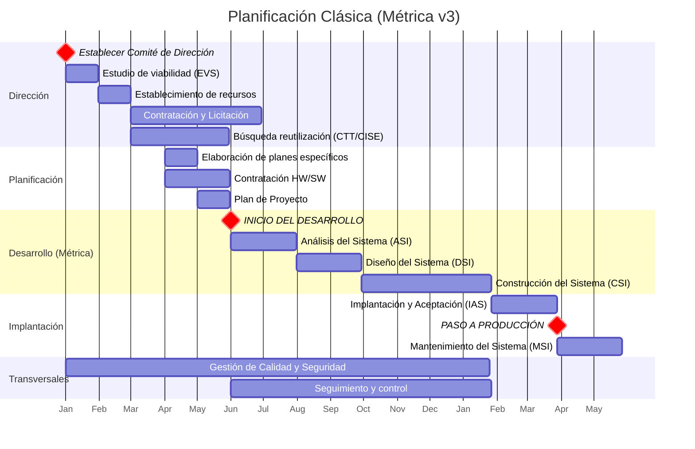

## Planificación Clásica (Métrica v3)

> *Cronograma de alto nivel basado en los procesos principales de Métrica v3.*

| Actividad / Tarea | 0 | 1 | 2 | 3 | 4 | 5 | 6 | 7 | 8 | 9 | 10 | 11 | 12 |
| :--- | :-: | :-: | :-: | :-: | :-: | :-: | :-: | :-: | :-: | :-: | :-: | :-: | :-: |
| **ESTABLECER COMITÉ DE DIRECCIÓN** | Hito | | | | | | | | | | | | |
| Estudio de viabilidad del sistema (EVS) | X | | | | | | | | | | | | |
| Establecimiento de recursos | | X | | | | | | | | | | | |
| Contratación del equipo / Licitación | | | X | < | < | < | | | | | | | |
| Búsqueda de reutilización (CTT / CISE) | | | X | < | | | | | | | | | |
| Elaboración de planes específicos | | | | X | | | | | | | | | |
| Contratación del equipamiento HW/SW | | | | X | < | | | | | | | | |
| Elaboración del Plan de Proyecto | | | | | X | | | | | | | | |
| **INICIO DEL DESARROLLO** | | | | | | Hito | | | | | | | |
| Análisis del Sistema (ASI) | | | | | | X | < | | | | | | |
| _ Especificación de requisitos | | | | | | x | < | | | | | | |
| _ Especificación del plan de pruebas | | | | | | | x | | | | | | |
| Diseño del Sistema (DSI) | | | | | | | | X | < | | | | |
| Construcción del Sistema (CSI) | | | | | | | | | X | < | < | < | |
| _ Programación | | | | | | | | | x | < | | | |
| _ Pruebas unitarias | | | | | | | | | | x | | | |
| _ Pruebas de integración | | | | | | | | | | | x | | |
| _ Pruebas del sistema | | | | | | | | | | | | x | |
| _ Elaboración de Manuales de Usuario | | | | | | | | | | | x | < | |
| Implantación y Aceptación (IAS) | | | | | | | | | | | | X | < |
| _ Instalación de equipamiento | | | | | | | | | | | | x | < |
| _ Formación de usuarios | | | | | | | | | | | | x | < |
| _ Pruebas de implantación | | | | | | | | | | | | | x |
| _ Elaboración del plan de mantenimiento | | | | | | | | | | | | x | < |
| _ Pruebas de aceptación | | | | | | | | | | | | | x |
| **PASO A PRODUCCIÓN** | | | | | | | | | | | | | Hito |
| Mantenimiento del Sistema (MSI) | | | | | | | | | | | | | X |
| Seguimiento y control del proyecto | | | | | | X | < | < | < | < | < | < | < |
| Gestión de Calidad, Seguridad y Configuración | X | < | < | < | < | < | < | < | < | < | < | < | < |

!!! note "Nota"
    La tabla representa los meses de duración (0 a 12). `X` marca el inicio de la tarea y `<` su continuación.

---

## Planificación Ágil ([SCRUM](../../apuntes/B3/01-ciclo_vida.md#scrum))

Se utilizará el marco de trabajo SCRUM, ideal para entornos con requisitos cambiantes y necesidad de entregas tempranas de valor.

### 👥 El Equipo Scrum (Scrum Team)
* **Product Owner (PO):** Con dedicación de al menos un 50%. (Ej. *El Jefe de Área*).
    * *Adaptación en la AAPP:* En caso de ser necesario, se contemplará la inclusión de un perfil **Product Owner Proxy** (Ej. *El Jefe de Servicio*) para facilitar la iteración diaria en caso de que el PO titular tenga poca disponibilidad o alta carga burocrática institucional.
* **Scrum Master:** Con dedicación de al menos un 50%. Actuará como facilitador y eliminará impedimentos.
* **Development Team:** Equipo de construcción multidisciplinar de entre 5 y 9 miembros a tiempo completo.

### 📅 Eventos y Ciclo de Vida
El desarrollo se realizará en iteraciones (**Sprints**) de 2 a 3 semanas de duración, que contendrán las siguientes ceremonias:
1.  **Sprint Planning:** Planificación de lo que se va a construir en la iteración.
2.  **Daily Scrum:** Sincronización diaria del equipo (15 minutos).
3.  **Sprint Review:** Demostración del incremento de producto al final del Sprint.
4.  **Sprint Retrospective:** Reunión de mejora continua del equipo antes de iniciar el siguiente Sprint.

### 🗺️ Hoja de Ruta (Roadmap)

Se designará un **Sprint 0** para labores de viabilidad y arquitectura base:
* Estudio de viabilidad del sistema (EVS).
* Búsqueda de soluciones reutilizables en el CTT y modelos de datos en el CISE.
* Definición de la arquitectura base, configuración de entornos y creación del *Product Backlog* inicial.

Como orientación inicial, se reparte la carga de trabajo en los siguientes Sprints para construir el producto de forma incremental:

* **Sprint 1:** Desarrollo del Sub-sistema 1 (Ej. *Módulo de autenticación con Cl@ve y alta de solicitud*).
* **Sprint 2:** Desarrollo del Sub-sistema 2 (Ej. *Bandeja de tramitación del funcionario y conexión a PID*).
* **Sprint 3:** Desarrollo del Sub-sistema 3 (Ej. *Módulo de resoluciones e integración con Notific@*).
* **Sprint N:** ...

De esta manera, el desarrollo core estará finalizado en *X* meses, entregando software funcional desde el primer mes.

### 🔧 Fase de Mantenimiento (Transición a Kanban)
Si para la fase de mantenimiento (correctivo y evolutivo menor) se detecta una carga de trabajo insuficiente o demasiado impredecible para mantener la cadencia estricta de los Sprints de Scrum, se optará por transicionar a un esquema ágil basado en **Kanban**, operado por un equipo reducido de soporte e incidencias enfocado en el flujo continuo de valor y limitación del trabajo en progreso (WIP).