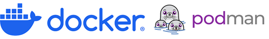
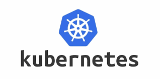
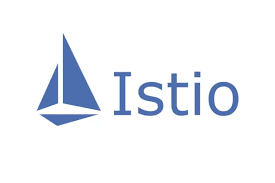
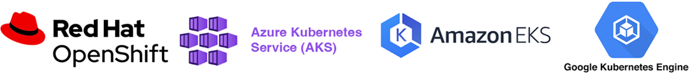
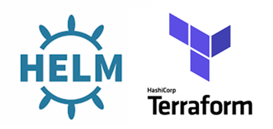
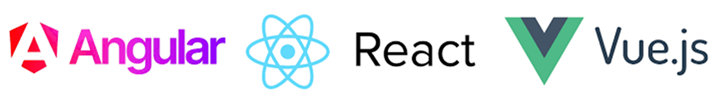
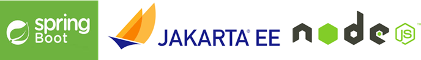
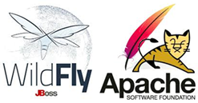
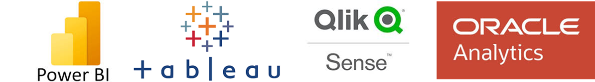
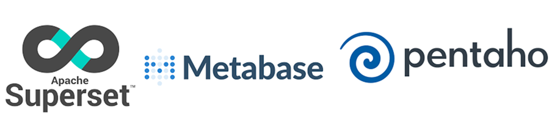

# 🏗️ Stack Tecnológico y Arquitectura

## ☁️ Microservicios y Cloud Native

!!! abstract "Cuándo proponer esta arquitectura en el examen"
    Proponla cuando el enunciado pida **alta escalabilidad**, **modernización de sistemas legacy**, picos de demanda impredecibles, o un enfoque **Cloud Native**. 

    * Front-end SPA + API Gateway + Microservicios (Spring Boot/Quarkus) + Contenedores (Docker) + Orquestación (Kubernetes).
    * Si hay comunicación masiva entre ellos, añade *Kafka* (Broker) e *Istio* (Service Mesh).

### Framework Backend

| Tecnología / Herramienta | Descripción |
|:---|:---|
| **Spring Boot, Quarkus, Micronaut** | Desarrollo en Java. Quarkus y Micronaut están altamente optimizados para contenedores y arranque rápido. |

### API Gateway

| Tecnología / Herramienta | Descripción |
|:---|:---|
| **Spring Cloud Gateway, Kong** | Punto de entrada único para exponer, enrutar y proteger la API REST. |

### Contenedorización

| Tecnología / Herramienta | Descripción |
|:---|:---|
| **Docker, Podman** | Empaquetado de aplicaciones y sus dependencias (estándar de la industria). |

### Orquestación

| Tecnología / Herramienta | Descripción |
|:---|:---|
| **Kubernetes (K8s)** | El estándar absoluto para desplegar, escalar y gestionar contenedores en clústeres. |

### Service Mesh

| Tecnología / Herramienta | Descripción |
|:---|:---|
| **Istio** | Gestiona el enrutamiento complejo, la seguridad (mTLS) y la observabilidad entre microservicios. |

### Message Broker (Mensajería)

Comunicación asíncrona.

| Tecnología / Herramienta | Descripción |
|:---|:---|
| **Apache Kafka** | Kafka para streaming masivo de eventos. |
| **RabbitMQ** | RabbitMQ para colas tradicionales. |

### Plataformas PaaS / CaaS

| Entorno | Tecnología / Servicio | Descripción |
|:---|:---|:---|
| **Nube Privada** | **Red Hat OpenShift** | Plataforma empresarial basada en Kubernetes (muy usada en la AAPP). |
| **Nube Pública** | **AKS** (Azure), **EKS** (AWS), **GKE** (Google) | Servicios gestionados de Kubernetes en los principales proveedores Cloud. |

### Despliegue e Infraestructura

| Tecnología / Herramienta | Descripción |
|:---|:---|
| **Helm** | Helm como gestor de paquetes de K8s. |
| **Terraform** | Terraform para Infraestructura como Código (IaC). |

## 🏢 Arquitectura Multicapa (Monolito o Front/Back)

!!! abstract "Cuándo proponer esta arquitectura"
    Úsala para **sistemas departamentales pequeños**, aplicaciones legacy que se van a mantener sin migrar a Cloud, o si el enunciado pide explícitamente una solución **multicapa tradicional** (Presentación, Negocio, Datos). 

    * Front-end (Angular/React) + Servidor Web (Nginx) + Backend monolítico (Spring Boot) + BBDD Relacional.

### Front-end (SPA)

| Tecnología / Herramienta | Descripción |
|:---|:---|
| **Angular, React, Vue.js** | Frameworks y librerías basados en TypeScript/JavaScript + HTML5 + CSS3. |

### Back-end

| Tecnología / Herramienta | Descripción |
|:---|:---|
| **Spring Boot, Node.js, Jakarta EE** | Lógica de negocio en el servidor. *(Nota: Evitar proponer Struts hoy en día).* |

### Servidor Web / Proxy Inverso

| Tecnología / Herramienta | Descripción |
|:---|:---|
| **Nginx, HAProxy** | Balanceo de carga y proxy inverso frente al servidor de aplicaciones. |

### Servidor de Aplicaciones

| Tecnología / Herramienta | Descripción |
|:---|:---|
| **Tomcat, Wildfly (Undertow)** | Normalmente embebidos en Spring Boot. *(Nota: Undertow es el motor por defecto en Wildfly).* |

### Persistencia y Web Services

| Categoría | Tecnología / Concepto | Descripción |
|:---|:---|:---|
| **ORM** | **Hibernate, JPA** | Mapeo objeto-relacional (Java Persistence API). |
| **Patrones de Carga** | **Lazy / Eager loading, DTOs** | Estrategias para optimizar consultas a base de datos y transferencia de objetos. |
| **Caché en memoria** | **Redis, Memcached** | Redis es el estándar actual para caché distribuida. |
| **Web Services (Modernos)**| **API RESTful, GraphQL** | Basados en JSON + especificación OpenAPI/Swagger. |
| **Web Services (Legacy)** | **SOAP + WSDL** | Interoperabilidad estricta apoyada en estándares como WS-Security. |

## 🗄️ Bases de Datos (Estrategia de Persistencia)

!!! abstract "Cuándo proponer cada Base de Datos"
    * **PostgreSQL:** Es la "vieja confiable" y la respuesta por defecto para la AAPP hoy en día (Open Source, potente, gratuita). Úsala para datos estructurados (expedientes, ciudadanos).
    * **Oracle:** Proponla SOLO si el enunciado menciona "un sistema legacy crítico", "gran volumen de transacciones complejas" o "ya existen licencias corporativas". Es muy cara.
    * **MySQL / MariaDB:** Ideal para portales web ligeros o CMS (WordPress, Drupal).
    * **NoSQL (MongoDB):** Proponla para catálogos con esquemas flexibles (JSON), historiales médicos o cuando el esquema de datos cambia constantemente.
    * **Elasticsearch:** Imprescindible si te piden un "motor de búsqueda rápida" sobre documentos.

| Categoría | Tecnología / Herramienta | Descripción y Caso de Uso |
|:---|:---|:---|
| **Relacional (Open Source)**| **PostgreSQL, MariaDB** | Transaccionalidad ACID perfecta. PostgreSQL es el estándar de facto actual en AAPP para evitar el *vendor lock-in*. |
| **Relacional (Comercial)** | **Oracle DB, MS SQL Server** | Sistemas críticos empresariales. Alta disponibilidad robusta (Oracle RAC) pero coste de licenciamiento alto. |
| **NoSQL (Documental)** | **MongoDB, Couchbase** | Almacena datos en formato JSON/BSON. Alta escalabilidad horizontal y esquemas flexibles. |
| **NoSQL (Clave-Valor)** | **Redis** | Persistencia ultrarrápida en memoria. Ideal para gestionar sesiones de usuario o cachés. |
| **NoSQL (Búsqueda)** | **Elasticsearch, Apache Solr**| Motores de búsqueda de texto completo. Rápidos indexando millones de registros desestructurados. |
| **NoSQL (Series Temporales)**| **InfluxDB, Prometheus** | Monitorización de infraestructuras o dispositivos IoT. |

## 🛡️ Seguridad e Infraestructura Perimetral (Hardware/Red)

!!! abstract "Cuándo proponer estos elementos en el examen"
    Para cumplir con el **Esquema Nacional de Seguridad (ENS)**, la arquitectura de red debe tener "defensa en profundidad".
    
    * **WAF:** OBLIGATORIO si tu sistema expone una web o una API a Internet (protege contra el OWASP Top 10).
    * **NGFW:** Para el control del perímetro corporativo (segmentación de redes, VPN, control de aplicaciones).
    * **SIEM:** OBLIGATORIO para cumplir con la medida del ENS de "Registro de actividad y detección de anomalías".
    * **Balanceador de Carga (ADC):** Siempre que necesites Alta Disponibilidad (HA) y para hacer la "terminación SSL" (descargar a los servidores del trabajo de cifrar/descifrar HTTPS).

| Elemento de Red | Tecnología / Referencia | Descripción y Propósito Arquitectónico |
|:---|:---|:---|
| **WAF** (Web App Firewall) | F5 Advanced WAF, Imperva, ModSecurity | Inspecciona el tráfico HTTP/HTTPS a nivel de capa 7 para bloquear Inyecciones SQL, XSS y bots maliciosos. |
| **NGFW** (Next-Gen Firewall)| Fortinet, Palo Alto, Check Point | Firewall de nueva generación (Capa 3 a 7). Realiza segmentación de red, filtrado IPS/IDS y terminación de VPNs. |
| **Balanceador / ADC** | F5 BIG-IP, HAProxy, Nginx Plus | *Application Delivery Controller*. Distribuye el tráfico entre nodos, realiza terminación SSL/TLS y asegura Alta Disponibilidad. |
| **SIEM** | Splunk, IBM QRadar, Wazuh (Open Source) | Recolecta, correlaciona y alerta sobre eventos de seguridad de toda la infraestructura. Clave para auditorías. |
| **Proxy Inverso** | Nginx, Apache HTTP Server | Se sitúa delante de los servidores de backend. Oculta la topología interna y sirve contenido estático (caché). |
| **HSM** (Hardware Security Module) | Thales, Entrust | Hardware criptográfico dedicado y blindado para generar y custodiar certificados, claves y firmas electrónicas. |

## 📱 Movilidad

!!! abstract "Cuándo proponer cada enfoque"
    * **Multiplataforma (Flutter/React Native):** Proponlo *siempre* por defecto para la AAPP. Ahorra costes, unifica equipos y reduce el *Time-to-Market*. 
    * **Nativa (Kotlin/Swift):** Propónlo **solo** si el enunciado exige un uso intensivo y muy específico del hardware (ej. escaneo 3D avanzado, biometría de muy bajo nivel).

!!! note "Tip para el examen"
    Mencionar la medida **"App Factory"** del eje 1 del Plan de Digitalización de las AAPP (creación de factorías de desarrollo de apps móviles).

| Categoría | Tecnología / Herramienta | Descripción |
|:---|:---|:---|
| **Nativa** | **Kotlin** (Android), **Swift** (iOS) | Rendimiento y acceso a hardware nativo. *(Nota: Java en Android es legacy).* |
| **Multiplataforma** | **Flutter** (Dart), **React Native** (JS) | Flutter es el estándar más demandado para código único multiplataforma. |
| **Otras alternativas** | **.NET MAUI, Ionic** | MAUI es el sucesor de Xamarin. Ionic se basa en Web Components híbridos. |
| **Firma Móvil** | **Cl@ve Móvil, Cliente @firma** | Herramientas oficiales del Estado para autenticación y firma electrónica. |

## 📊 Datos y Cuadro de Mando (BI / Analytics)

!!! abstract "Cuándo proponer estas tecnologías"
    * **BI Empresarial:** Cuando pidan Cuadros de Mando para la toma de decisiones de altos cargos o directivos.
    * **Data Warehouse:** Para consolidar datos estructurados (relacionales) de diferentes departamentos y hacer analítica histórica.
    * **Data Lake:** Si el enunciado habla de **Big Data**, datos desestructurados (PDFs, imágenes, redes sociales) o modelos de Inteligencia Artificial / Machine Learning.

!!! note "Arquitecturas modernas: *Data Mesh*"
    Infraestructura distribuida donde múltiples dominios autónomos exponen sus propios **"productos de datos"**. Elimina cuellos de botella del IT centralizado.

### Herramientas de Visualización y BI

#### BI Empresarial

| Tecnología / Herramienta | Descripción |
|:---|:---|
| **Power BI, Tableau, Qlik** | Soluciones comerciales líderes en cuadros de mando interactivos. |

#### BI Open Source

| Tecnología / Herramienta | Descripción |
|:---|:---|
| **Apache Superset, Metabase** | Alternativas de código abierto sin coste de licenciamiento. |

#### Reporting Clásico

| Tecnología / Herramienta | Descripción |
|:---|:---|
| **JasperReports, Cognos** | Generación de informes estáticos, operativos y paginados. |

### Almacenamiento Analítico

| Categoría | Tecnología / Herramienta | Descripción |
|:---|:---|:---|
| **Data Warehouse** | **Snowflake, BigQuery, Synapse** | Almacenes de datos estructurados optimizados para consultas analíticas SQL rápidas. |
| **Data Lake** | **Amazon S3, ADLS Gen2, Hadoop** | Repositorios masivos para datos brutos (estructurados y no estructurados). |

## ⚙️ DevOps, Pruebas y Calidad de Código

!!! abstract "Integración Transversal"
    **Las prácticas DevOps y de Pruebas deben incluirse SIEMPRE.** Da igual si te piden un monolito o microservicios. En el examen, mencionar un pipeline CI/CD con *SonarQube* (calidad estática) y despliegue automatizado asegura puntos en el apartado de "Ciclo de vida / Gestión del proyecto".

| Fase / Categoría | Tecnología / Herramienta | Descripción |
|:---|:---|:---|
| **Pruebas Unitarias** | **JUnit, Mockito** | Verificación de código aislado. Mockito se usa para simular dependencias falsas (mocks). |
| **Pruebas E2E** | **Cypress, Selenium** | Pruebas "End-to-End" que simulan la interacción del usuario real en el navegador. |
| **Pruebas de Rendimiento**| **JMeter, Gatling** | Pruebas de carga, estrés y picos de tráfico. |
| **Calidad de Código** | **SonarQube** | Análisis estático de código para garantizar que se cumplen las *Quality Gates*. |
| **CI / CD** | **GitLab CI/CD, Jenkins** | Integración y Despliegue Continuo (automatización de pipelines). |
| **Construcción (Build)** | **Maven, Gradle** | Resolución de dependencias y compilación de proyectos (ej. Java). |

## 🤖 Inteligencia Artificial y Transversales

!!! abstract "Cuándo proponer IA y Observabilidad"
    * **IA / Chatbots:** Ideal si el supuesto pide "mejorar la atención al ciudadano", "reducir carga en el nivel 1 de soporte" o "modernizar servicios".
    * **Observabilidad (ELK/Prometheus):** Obligatorio mencionarlo si diseñas una arquitectura de **microservicios**, ya que al haber tantas piezas, la centralización de logs es crítica para el ENS.

| Categoría | Tecnología / Herramienta | Descripción |
|:---|:---|:---|
| **Chatbots IA Generativa** | **OpenAI, HuggingFace, LangChain**| LLMs orquestados mediante frameworks como LangChain. |
| **Chatbots Clásicos** | **Dialogflow, Watson Assistant** | Asistentes basados en árboles de decisión e intenciones predefinidas. |
| **Observabilidad / Logs** | **Stack ELK** | Elasticsearch + Logstash + Kibana para recolectar y buscar trazas corporativas. |
| **Métricas** | **Prometheus + Grafana** | Prometheus extrae métricas de sistemas; Grafana las visualiza en paneles. |
| **Estrategias Despliegue** | **Blue-Green, Canary** | Despliegues *Zero-Downtime* (sin cortes de servicio). |
| **Licencias Open Source** | **EUPL, GPL, Apache 2.0** | EUPL es la licencia pública recomendada por la Unión Europea para la AAPP. |